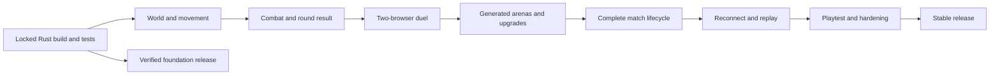

# Grenadiers Implementation and Release Plan

Status: **execution plan**. M0 is complete and locally verified on 2026-10-16; M1 is complete
and locally verified on 2026-10-17. M2 is complete and locally verified
on 2026-10-17. M3’s fixed-map two-browser duel is implemented and locally verified;
M4 generated rounds and upgrades are complete and locally verified on 2026-10-17;
M5 is complete and locally verified on 2026-10-17: v3 contracts, real match ownership,
first-to-three progression, and rematches pass exact-image Compose/Kubernetes acceptance.
M6 reconnect/replay is implemented with all 42 baseline rules mapped to automated assertions.
M6 is complete and locally verified on 2026-10-17, including exact-image deployment acceptance.
M7 hardening has started; M8 remains planned.
Wall Pass is published as the eighteenth requested item in
[v0.3.43](https://github.com/liveweird/grenadiers/releases/tag/v0.3.43). Source
`c086f719ea470b9fe24963adef84b5e3bdf3e17a`, tree
`d74fad8a1c870f2834fca48f80ea4e38f0c512d9`, passes first-attempt candidate, master and tag
workflows and is locally promoted on exact image
`sha256:577abb32958e45912f35a7f6ae68dd624deb6515d2b4d55519942c44436a2a01`.
The 110 native cases remain attributed to H2 source `11d0dc7`; reviewed retained-artifact equality
connects corrected source `5dbcd58` to the published source without claiming unchanged Docker
inputs, a new Rust compilation or new native execution. At the 2026-10-24 native-acceptance
checkpoint, eighteen requested item types are published. Kick candidate
`cb70cba891ed972380f30f52133622ce36fd9ee8` passes fresh source-bound
Rust, web, security and complete 524,288-mask gates for v0.3.44. Fresh 56+56 native acceptance
passes with zero retries or carried results and is independently audited, reviewed and sealed;
hosted CI and publication follow.
The v0.3.16 increment adds classic-v3 forgiving turns and explicit gameplay-v5 compatibility,
locally verified through both deployment paths on 2026-10-17.
The v0.3.17 increment adds four shared gameplay settings with configurable-v4 rules and
gameplay-v6 compatibility, locally verified through both deployment paths on 2026-10-17;
wider arena/item configuration remains backlog work.
v0.3.18 adds the first detailed retro pixel-art slice, verified through both deployment paths.
v0.3.19 adds verified core inventory/effect/damage foundations; expanded items remain disabled.
v0.3.21 adds typed bomb triggers and checked legacy projection without activating new weapons.
v0.3.20 retains ordered manual actions while preserving Classic placement and private replay,
verified through both deployment paths.
Published engineering prereleases are listed in `CHANGELOG.md` and GitHub Releases.
At the 2026-10-24 native-acceptance checkpoint, eighteen requested item types are published through
v0.3.43. For Wall Pass, each Rust profile
passes 711 core and 209 server tests with four historical ignores, the web gate passes
797 tests across 64 files, all 56 scenarios pass, and all 262,144 settings masks complete in each
profile. Native acceptance covers 55 cases per target with zero retries or carry. Kick, Punch,
Bracelet and Oil Barrel remain, followed by ART-ATLAS after the feature batch.

New playtest requests and expansion work are tracked in the [gameplay and presentation
backlog](backlog.md): forgiving turns first, shared gameplay settings, detailed retro pixel art,
then equipment, timed buffs/curses and single-use weapons. TURN is M7 playability work;
expanded item mechanics are optional ruleset tracks, not additional classic release blockers.

The first product goal is a reliable, browser-based survival match between two humans. Build
on the existing Rust/React scaffold, prove combat in two independent browsers early, then
complete the classic rules and network lifecycle. Bots, more players, advanced weapons, and
a campaign are separate expansion tracks.

The [rules specification](rules.md) is the gameplay reference. Use its initial Grenadiers
profile as the working baseline; its historical catalog does not add features to the initial
scope. Numerical defaults remain tunable. Record implementation decisions before the affected
code, without waiting for every optional feature or an exact historical port to be chosen.

## Current starting point

The repository contains versioned HTTP/WebSocket contracts, anonymous sessions, bounded
two-seat rooms, authoritative 60 Hz simulation, and checked public snapshots/events. M1–M2
provide movement, owned bombs, flames, damage, and round finality. M3 adds readiness/countdown
and a playable PixiJS arena with React controls, native keyboard handling, and EN/PL localization.
Automated gates, CI, Compose, and Kubernetes validate the stack. M4 adds generated arenas,
private seeds, and upgrades. M5 adds series scoring and rematches; v0.3.9 activates v4 reconnect
and private replay. M7 adds measured runtime/ordered-message-delay references, real visibility
recovery, persistent keyboard remapping and optional gesture-enabled sound. Human playtesting
and the broader browser/network support decision remain open.

The [verification record](../verification.md) now contains passing locked Rust builds, tests,
coverage, dependency audits, Compose execution, strict Kubernetes validation and live rollout,
two-browser scenarios through both deployment paths, and the configured image scan. A real
`Cargo.lock` and resolved base-image digests replace the earlier bootstrap placeholders.
`AGENTS.md` remains unchanged under the original preservation instruction;
`CONTRIBUTING.md` contains current engineering conventions.

M0 also hardened nested realtime type generation, rendered Kubernetes invariants, API linting,
and text contrast, with independent review and regression tests. The shared gate passes
11 Rust and 29 web/tooling tests at that checkpoint. M1 extends the workspace to 58 Rust unit
tests and one API documentation test. Product/package/protocol version ownership and the candidate
procedure are documented in [releases](../releases.md).

## Planned releases

These are milestone release labels, not a calendar commitment. Headless work ships in small
`0.1.x` prereleases before the playable `0.2.0` preview. GitHub Releases records published tags;
Cargo tracks the product candidate and private npm package versions remain build metadata.

| Release | User-visible or engineering outcome | Milestones |
| --- | --- | --- |
| **v0.1.0 Verified foundation** | Reproducible Rust/web build, green required gates, and demonstrated Compose/Kubernetes startup. Internal engineering checkpoint. | M0 |
| **v0.2.0 Duel preview** | Two people join one room, move, plant bombs, destroy blocks, and finish a round in two browsers. Fixed map and basic bombs. | M1, M2, M3 |
| **v0.3.0 Classic matches** | Generated fair arenas, three initial upgrades, countdowns, first-to-three scoring, draws, resets, and rematch. | M4, M5 |
| **v0.4.0 Resilient playtest alpha** | Reconnect/forfeit correctness, complete baseline rule coverage, deterministic replay evidence, and measured two-player playability. | M6, M7 |
| **v1.0.0 Stable two-player game** | The baseline survives the agreed playtest, operational, compatibility, and release gates. | M8 |

v0.2 and v0.3 are explicitly limited previews. Before v0.3.9, transport loss interrupts a
match. v0.3.9 activates a strict 600-tick reserved-seat grace with same-process full-state
recovery; process restart/deployment still loses rooms and capabilities. All earlier gameplay
capabilities remain regression-tested; v0.4 waits for M7 playtest/hardening evidence.

The first playable checkpoint occurs in M3; do not postpone browser integration until all
simulation features, final artwork, or reconnect support are finished.

## Dependency and ownership model

Keep simulation rules in `core/` and I/O in `server/`. The server owns each match in memory,
with one authoritative update loop and bounded command queues. `web/` sends intentions and
renders public state. `api/` defines wire contracts. Do not require PostgreSQL or Redis for
live play, add replicas, or distribute match ownership in this plan.

Contracts and domain interfaces precede dependent work. Once they are concrete, frontend,
server adapters, and independent verification can progress in parallel with disjoint file
ownership. An implementation worker cannot independently review its own changes. The
coordinator integrates results and checks the milestone exit criteria.

## M0 Establish a verified foundation

**Release:** v0.1.0. **Depends on:** access to dependency registries, Git writes, Docker, and a
suitable isolated local Kubernetes environment.

Work packages:

- Resolve dependencies with Cargo, review and commit the real `Cargo.lock`, and fix actual
  compilation, test, Clippy, dependency-policy, and measured coverage failures.
- Confirm exact toolchain/dependency pins and generated contracts. Establish consistent
  product-release metadata and document the version/tag procedure.
- Build the combined image from a clean checkout; resolve and verify outstanding Rust/runtime
  image digests. Exercise health/readiness, static assets, SPA fallback, and real WebSockets.
- Complete the existing two-browser diagnostic scenario against Compose. Run strict rendered
  Kubernetes schema checks, then deploy the same image in an isolated namespace and verify
  rollout, probes, static UI, and WebSocket exchange through the intended access path.
- Run optional database readiness both without PostgreSQL and with configured database
  failure/recovery. No application schema is needed.
- Refresh verification/deployment documentation with command results and real limitations.

**Ownership:** root build/toolchain files, CI and scripts; targeted fixes in whichever module
fails. Keep unrelated game implementation out of this checkpoint.

**Exit:** all gates in the release checklist below pass on the release candidate. The diagnostic
stack starts from a clean checkout in Compose and Kubernetes. Environment-denied checks remain
open; configuration rendering alone does not satisfy runtime acceptance.

**Implementation prerequisite (passed):** resolve `Cargo.lock` and get `cargo build`, Clippy,
and Rust tests passing with locked dependencies before building a new simulation. Core
implementation may proceed once this prerequisite passes, even if deployment validation is
still running. Compose/Kubernetes runtime checks remain requirements for every release claim;
M0 now has this local evidence too. M1 has since supplied the domain decisions, fixtures,
and pure movement implementation below.

## M1 Build the world and movement model

**Depends on:** M0's locked Rust build, Clippy, and tests for implementation; complete M0 for
a releasable result. Design/fixture preparation can run while dependency access is restored,
but cannot be reported as a verified Rust milestone.

Work packages:

- Establish stable cell/entity/seat/tick identifiers and separate terrain, blocks, actors,
  bombs, pickups, and hazard layers. Add one hand-authored, validated two-spawn arena fixture.
- Define fixed-point position units, movement residuals, collision geometry, turning
  assistance, and exact boundary conventions from the working ruleset.
- Implement cardinal movement, held-direction priority, stopping, non-blocking players,
  collision sweeps, and temporary bomb-overlap support as a tested rule interface.
- Define versioned rules configuration and deterministic state comparison. Keep browser or
  wall-clock types out of the domain API.

**Ownership:** `core/`; ADRs in `docs/decisions/`. Server/frontend consumers depend on a reviewed
`step(state, inputs)`-style boundary; its exact Rust signature is an implementation decision.

**Exit:** deterministic movement tests cover walls, corners, reversal, boundary positions,
maximum speed, and overlapping players. A repeated input sequence yields identical positions.
No renderer or network service is required to run these tests.

**Completed evidence:** [ADR 0002](../decisions/0002-deterministic-movement.md) records integer
geometry, fractional travel, strict turn eligibility, and ordered inputs. The
[headless API](movement.md) has 49 core unit tests plus a runnable documentation example;
the workspace Rust gate and unchanged coverage floor pass at 90.07% lines. Independent review
findings were fixed and regression-tested. [ADR 0003](../decisions/0003-arena-rendering.md)
selects PixiJS for M3; M1 installs no graphics dependency. The next bounded task is M2 combat.

## M2 Implement bombs and one-round combat

**Depends on:** M1.

Progress: v0.1.2 implements owned bomb placement; v0.1.3 adds fuse execution, immutable chain
planning, block destruction, and timed flames. v0.1.4 adds damage, exact timeout, and immutable
round outcomes. v0.1.5 adds explicit public projections and actual-phase events, completing
the headless implementation. See [combat phases](combat.md),
[ADR 0004](../decisions/0004-bomb-placement.md), and
[ADR 0005](../decisions/0005-explosion-snapshot.md).

Work packages:

- Add placement eligibility, per-owner capacity, placement-time property snapshots, and
  overlap grace for every affected player. Resolve conflicting eligible placements together.
- Implement fuse deadlines, cardinal blast rays, the single occupancy snapshot for a complete
  same-tick chain, and exactly-once detonation/capacity release.
- Implement flame lifetimes/overlap, soft-block destruction, swept fire contact, simultaneous
  deaths, sole-survivor/draw results, and the exact round deadline.
- Add domain events and a public-state projection. Never expose the internal world wholesale
  as a browser snapshot.

**Ownership:** `core/`, with fixtures/tests independent of server scheduling.

**Completion evidence:** 97 core unit tests plus a public API doctest pass; workspace line
coverage is 93.95% with the unchanged floor. Independent review, clean image build, Compose,
live Kubernetes, browser diagnostics, strict schemas, and image scan pass. See
[verification](../verification.md).

**Exit:** a headless two-player round can finish deterministically. Golden scenarios prove
chain order independence, simultaneous wall hits, placement/grace behavior, self-elimination,
and deadline/expiry boundaries. The round result is decided after complete damage resolution.

## M3 Make the duel playable in two browsers

**Release:** v0.2.0. **Depends on:** M2 and reviewed gameplay contracts.

Progress: v0.1.6 adds bounded-schema generation; v0.1.7 defines strict gameplay control/lifecycle
messages in Rust, JSON Schema, and generated TypeScript. v0.1.8 adds bounded snapshots/events,
and v0.1.9 checks domain-to-wire conversion. v0.1.10 adds bounded anonymous HTTP sessions.
v0.1.11 adds the headless room lifecycle; v0.1.12 authenticates gameplay sockets; v0.1.13 adds
bounded networked room ownership/admission. v0.1.14 runs authoritative fixed-map rounds with
bounded input and checked publication. v0.2.0 adds the playable PixiJS/React interface and
actual two-browser duel acceptance. See the
[protocol boundary](protocol.md). Diagnostic transport stays independently supported.

Work packages:

- Specify room creation/joining, two-seat admission, anonymous seat ownership, ready/start,
  and preview interruption. Use anonymous credentials in the first authenticated frame; never
  place seat/reconnect credentials in URLs or logs. Origin checks are not identity.
- Add gameplay messages alongside or separately from diagnostic ping/pong: sequenced movement,
  uniquely identified bomb actions, public snapshots/events, round results, and errors.
  Define the gameplay protocol version and compatibility handshake before adding messages.
  Preserve the strict diagnostic v1 contract or isolate the new endpoint; an unsupported or
  stale client must receive a clear incompatibility result before admission or control.
  Update JSON Schema/OpenAPI, runtime validation, generated TS, and conformance tests together.
  Keep nested snapshots covered by generation/type-check tests; extend the small generator's
  explicit supported subset when necessary, without silent fallback types.
- Implement one server-owned match loop with bounded queues, input expiry, action de-duplication,
  fixed tick scheduling, and an explicit overload/catch-up policy. Bound room creation and
  seat claims as well as per-room input; cap message size and idle session lifetimes from the
  first network release. Bind actions to the owned
  seat, current match/round, and connection generation; stale round inputs cannot act after reset.
  A slow reader must not block
  the simulation or another player.
- Build a simple arena view with readable floor, walls, characters, bombs, flames, timer,
  connection state, and round result. React owns the room/HUD; select the initial arena renderer
  in an ADR before integration. Final art/audio is not required for this checkpoint.
- Wire keyboard controls, focus-loss input clearing, rendering interpolation, and two independent
  browser contexts. Preserve typed EN/PL text and accessible menu controls.

**Ownership:** coordinator owns the approved contracts/interface boundary; developers separately
own `server/`, `web/`, and `e2e/` once those contracts are ready. Serialize shared schema edits.

**Exit:** using the built stack, two browsers join the same room, take distinct seats, move,
place bombs, see consistent destruction/deaths, and observe the same round result. A third
connection cannot claim an occupied seat or control either player. Replayed actions do not
create extra bombs. Transport loss produces the documented preview interruption. Server and
browser cases cover both-ready admission, configuration locking, pre-start cancellation,
and incompatible client versions without mutating a room.

**Preview limits:** fixed arena; no generated pickups, complete series scoring, or reconnection
promise. These limits are visible in release notes and do not masquerade as full ruleset support.

## M4 Add generated arenas and the three initial upgrades

**Depends on:** M3.

Progress: v0.2.1 adds the explicit [versioned generator](generation.md), private concealed
contents, deterministic fallback, and opening validation. v0.2.2 adds checked [pickup layers](pickups.md), reveal/destruction, and private
world construction. v0.2.3 adds headless collection, capped upgrades, and explicit round-number
spawn/tie assignment. v0.2.4 coordinates gameplay v2 and immutable room profiles. v0.2.5 adds
retained item graphics and localized authoritative upgrade HUDs. v0.2.6 activates generated
classic-v2 rooms, private seed handling, and separate random/fixture browser acceptance.

Work packages:

- Fix the generator algorithm/version and deterministic random draw semantics. Implement
  canonical mirrored-pair sampling, reserved spawn areas, validation, and deterministic fallback.
- Generate concealed contents before play; separate public projection from secret seed/content.
  Alternate spawn corners and collection tie priority between rounds.
- Implement capacity/range/speed upgrades and caps, pending reveal after flames clear, exposed
  item destruction, final-position collection, and damage-before-collection behavior.
- Render upgrade levels, available bomb slots, exposed items, and their authoritative changes.

**Ownership:** domain generation/items in `core/`, projection in `server/`, UI in `web/`, and
an updated browser scenario in `e2e/`.

**Exit:** fixed-seed tests prove symmetry, safe openings, reproducibility, fallback behavior,
upgrade caps, and pickup timing. Snapshots and client bundles contain neither concealed items
nor active secret seeds. A two-browser scenario collects an item and proves its effect on a
new bomb while an older bomb retains its original range.

## M5 Complete classic match progression

Progress: v0.2.7 adds the headless [match-series component](match-series.md), bounded score/
record/outcome facts, holds, batched departures, and rematch votes. This staged release retains the
single-round v2 preview. v0.2.8 adds the pure [automatic match lifecycle](match-lifecycle.md).
v0.2.9 adds the dormant [v3 structural contract](protocol-v3.md); v0.2.10 adds checked room
projection and semantic validation. v0.2.11 adds the dormant real simulation adapter;
v0.2.12 adds the dormant browser client/panel; v0.2.13 adds bounded ownership and shutdown.
v0.3.0 activates production routing and bounded process drain. Full two-browser first-to-three/rematch
acceptance passes through Compose and Kubernetes, following [ADR 0015](../decisions/0015-match-series-and-staged-progression.md).

**Release:** v0.3.0. **Depends on:** M4.

Work packages:

- Implement waiting/readiness, initial and inter-round countdowns, first-to-three scoring,
  draws, round resets, match results, and consensual rematch.
- Reset upgrades/world state correctly, rotate spawns and tie priority, and generate a new
  round seed. Keep global match ticks separate from local round update counts.
- Implement explicit departure/forfeit and interrupted-server outcomes. The temporary
  connection-loss interruption profile remains in force until M6.
- Present scores, countdowns, win/draw/forfeit/interruption distinctions, and rematch controls.

**Exit:** two real browser contexts complete a full first-to-three match, including a draw
and a new round with reset upgrades. Exactly 10,800 Running updates precede a contested timeout.
A finalized result cannot be changed by later scheduled bombs. Rematch starts fresh scores.
Server/browser cases also verify the minimum three-second result hold, automatic next-round
countdown with retained scores, simultaneous explicit departures, and server interruption.

## M6 Implement reconnect resilience and complete replay evidence

Progress: v0.3.1 adds the independently reviewed pure [two-seat grace model](reconnect-grace.md).
These foundations were dormant until v0.3.9 coordinated activation.
v0.3.2 adds a bounded private [semantic replay runner](replay.md); v0.3.3 captures accepted
production operations with explicit incomplete/truncated evidence.
v0.3.4 integrates the grace-aware pure lifecycle; production still uses legacy v3 departures.
v0.3.5 stages the closed [v4 reconnect contract](reconnect-contract.md); v0.3.6 adds
checked [room/state/admission projection](protocol-v4.md) against the real lifecycle.
v0.3.7 stages private [resume credential and binding helpers](resume-bindings.md).
v0.3.8 stages the dormant [v4 reconnect browser](reconnect-browser.md).
v0.3.9 activates both adapters with settled owner scheduling, strict grace, full admission
baselines, takeover fences, and profile-2 private capture/replay. v0.3.10 closes three integrated
coverage gaps and publishes the complete [42-rule matrix](rule-coverage.md). Both v0.3.9 and
v0.3.10 pass all ten real browser scenarios through each exact-image Compose/Kubernetes path.
M6 engineering exit evidence is complete; measured M7 playtest/hardening is separate.

**Depends on:** M5.

Work packages:

- Replace preview interruption with reserved-seat reconnect credentials and the specified
  ten-second grace. Clear expired movement, retain vulnerable actors/bombs, and restore the
  same seat with a full public snapshot. Fence the replaced connection so an older tab/socket
  cannot keep controlling the seat or disconnect the newly resumed session.
- Advance reconnect deadlines through running rounds, result screens, and held inter-round
  transitions. Implement staggered dual disconnect, expired-seat rejection, abandonment,
  and round-win versus match-forfeit precedence.
- Record tick-assigned lifecycle events along with accepted commands. Include ruleset,
  generator version, seed, and starting configuration; keep replay access and active secrets
  separate. Replay does not require PostgreSQL or a public replay-sharing feature.
- Bound connection/session lifetimes and malformed/rate-limited input behavior. Verify that
  slow, stale, duplicate, or unauthorized clients cannot mutate another seat or stall a room.

**Exit:** all 42 baseline RULE scenarios have automated coverage at the correct test layer.
Server tests and browser reconnect scenarios prove lifecycle behavior; replaying accepted
commands plus lifecycle events reproduces authoritative states and results. No client clock,
animation, or socket callback decides match time or victory.
Opening menus or hiding a tab never pauses authoritative time; browser tests verify input
clearing and snapshot resynchronization on return. Completed and interrupted rooms release
their queues, timers, and seat credentials under bounded server lifecycle tests.

## M7 Playtest and harden the two-player game

v0.3.11 adds the [optimized runtime/owner reference harness](performance.md), including separate
queue pressure and exact artifact provenance. Clean native and Linux references pass selected
budgets at one/eight rooms; exact-image application acceptance remains a separate release check.
v0.3.12 adds real headed Chromium hidden-tab/return acceptance with unchanged server time and
native input release; owned process cleanup is bounded. v0.3.13 adds [persistent keyboard
remapping](controls.md), held-input clearing and localized accessible settings. v0.3.14 adds
[ordered WebSocket delay measurements](websocket-latency.md) with causal page-delivery and collision
proofs. v0.3.15 adds [optional procedural sound](audio.md), gesture-only activation, bounded voices
and replay-free hidden/visible recovery. Broader network/browser support and human playability remain open.

The next playability increment widens turn assistance to a quarter tile with classic-v3,
historical replay selection and gameplay-v5 compatibility. Native keyboard acceptance covers
a natural wall stop 192 units from center, outside the legacy turn window. Wider configuration
and the requested art/item expansion follow the [detailed backlog](backlog.md).

**Release:** v0.4.0. **Depends on:** M6.

Work packages:

- Measure the 60 Hz simulation and render/network behavior on a recorded reference environment.
  Establish and enforce budgets for tick execution, queue depth, snapshot size/cadence, room
  memory, and disconnected-session cleanup. Record tested room counts rather than claiming
  unmeasured capacity.
- Exercise direct local play and controlled delay/jitter/disconnect conditions. Choose a
  documented latency envelope and verify action ordering, movement release, snapshot recovery,
  and consistent outcomes throughout it.
- Playtest movement/turning, fuse/range/speed combinations, spawn fairness, item balance, and
  match duration. Change versioned configuration and its tests together when tuning.
- Improve readable animation, sound/mute support, player distinction beyond color, reduced
  effects, remappable controls, input/menu usability, and EN/PL coverage. Verify remapping
  persists and clears previous held inputs. Input rendering remains separate from rules.
- Finish admission/input abuse limits, shutdown/interruption reporting, operational logs,
  deployment probes, and the runbook. Keep tokens, hidden seeds, and message bodies out of logs.

**Exit:** the full baseline works across the agreed browsers and latency envelope, performance
budgets are measured and pass, and playtest-blocking defects are resolved. Any remaining known
issues are explicit and do not invalidate the release's supported behavior.

## M8 Release the stable two-player baseline

**Release:** v1.0.0. **Depends on:** M7 and the release checklist.

Run the candidate from a clean checkout, promote the exact tested image, verify version and
contract compatibility, and prepare a concise changelog with supported rules and known limits.
Document upgrade/rollback behavior: in-memory active matches do not survive a server restart.

**Exit:** reproducible artifacts, clean required checks, validated Compose and Kubernetes
operation, complete baseline acceptance evidence, and current player/operator documentation.
Tagging/publishing is an explicit release operation; this plan does not create releases.
Bots, more players, campaign content, and persistent accounts are not prerequisites for v1.0.

## Baseline acceptance traceability

Assignments below are planned test responsibilities, not passing-test claims. An ID can be
covered in more than one layer; all 42 must be implemented and passing by M6.

| Rules | First responsible milestone | Essential evidence |
| --- | --- | --- |
| 01–10, 12–16 | M2 | Geometry, obstruction, chains, capacity, grace, placement conflicts, flame time boundaries. |
| 17 | M1, extended in M2 | Swept collision at max speed, including later flame hazards. |
| 11, 18–20 | M4 | Placement-time range, reveal/destruction, and damage/collection order. |
| 21–25 | M2, exercised through M3 | Simultaneous elimination, result finality, dead-owner bombs, and timeout. |
| 26 | M1 and M3 | Direction/key-release model plus actual browser auto-repeat/focus handling. |
| 27 | M3 | Server-accepted action de-duplication and replay rejection. |
| 28–29 | M6 | Retained world/seat behavior and full-snapshot reconnection. |
| 30 | M5 | Score, draw, reset, and match completion. |
| 31 | M6 | Deterministic replay including external lifecycle events. |
| 32–34 | M4, checked again in M6 | Public information boundary, safe openings, symmetry, and seat rotation. |
| 35–37 | M6 | Dual disconnects, grace outside Running, and match-forfeit precedence. |
| 38 | M2 | Turn-assistance fire contact uses the normal swept hazard rule. |
| 39–40 | M4 | Collection beneath a bomb and re-burning a newly revealed item. |
| 41 | M2, checked again in M5 | Exactly 10,800 Running updates. |
| 42 | M2 | Invalid placement cannot deny an eligible placement. |

## Decisions before dependent implementation

| Decision | Needed by | Direction |
| --- | --- | --- |
| Ruleset identity and allowed tuning | M1 | Use a versioned initial profile from `rules.md`; record changes and fixtures together. |
| Fixed-point units, residual arithmetic, event ordering | M1/M2 | Follow the specification's cardinal/swept model; no float-dependent outcomes. |
| Public domain projection and transport schema | M3 | Keep secret map/item data out; generate and validate wire types. |
| Gameplay protocol version and compatibility | M3 | Reject unsupported clients before admission; preserve or separate diagnostic v1. |
| Anonymous seat credentials and admission | M3 | Server-validated ownership; no credentials in URLs; two seats per room. |
| Arena renderer and input presentation | M3 integration | PixiJS arena plus React/Mantine HUD selected in ADR 0003; pin the dependency and verify integration in M3. |
| Tick overload and snapshot cadence | M3 | Bound work/backpressure; measure before optimizing or adding prediction. |
| RNG and generator version | M4 | Explicit, reproducible algorithm and pair order; private active item seeds. |
| Reconnect identity and lifecycle replay format | M6 | Preserve seat and deadlines across match states; include external events. |
| Performance/browser/latency support envelope | M7 | Define against measurements and playtests, not guessed capacity claims. |

Prefer a short ADR with tradeoffs and acceptance checks for each cross-cutting choice. Do not
introduce speculative frameworks, distributed storage, or final art pipelines as prerequisites.

## Release checklist

Every release candidate must pass applicable existing guardrails without lowering coverage
floors or adding blanket suppressions. Preview features have explicit tested limits; an
unexecuted required check is an open release blocker, not a pass.

- `scripts/gates.sh all`: repository, locked Rust formatting/lint/tests/build, contract drift,
  frontend lint/dead code/coverage/build, and E2E static checks.
- `scripts/gates.sh coverage` and `scripts/gates.sh security`: Rust coverage and dependency policies/audits.
- `scripts/gates.sh browser`: actual multi-context scenarios against the built application.
- `scripts/gates.sh k8s`: invariant checks and strict rendered Kubernetes schemas.
- Clean image build and configured image vulnerability scan; Compose and Kubernetes runtime
  smoke checks for startup, probes, UI/API, and WebSockets. A clean render is insufficient.
- New unit/integration/property or permutation tests where behavior needs them; scenario docs
  and browser titles remain in parity. Record RULE coverage and actual outcomes.
- Independent review of substantive rule, protocol, security, and lifecycle changes. Verify
  edge cases at the affected layer rather than multiplying identical tests at every layer.
- Updated contracts, generated files, player/deployment docs, changelog, and verification record.
  Review staged source, commit focused changes, and tag only the tested release candidate.

The `all` target alone does not include security, Rust coverage, browser execution, or Kubernetes
validation. Release automation should make this full checklist mechanical as the first real
release is prepared.

## Expansion tracks after the two-player baseline

The [detailed backlog](backlog.md) records the requested configuration/art work and exact item
roster, slot rules, priorities and interaction decisions. Schedule bounded releases from that
backlog; the table below remains the broader expansion map.

Choose release numbers and priority after the first playtests. Each track gets a separate
ruleset increment and acceptance matrix; none is silently included in the initial milestone.

| Track | Deliverable | Prerequisites and limits |
| --- | --- | --- |
| More players | Start with four configurable seats, fair spawn layouts, multi-survivor results, and browser/room load tests. | Generalize seat counts; update the diagnostic `maxPlayers` promise and every affected contract intentionally. |
| Bot competitors | At least one fair AI controller with survival, escape planning, and simple offense; then difficulty levels. | Same validated command path and public information as humans; no hidden items or privileged physics. |
| Advanced abilities and arenas | Select one ability or hazard at a time: kick, remote bombs, line bombs, portals, conveyors, or sudden death. | Specify feature interactions and deterministic edge cases before enabling combinations. |
| Campaign and mobs | A small authored stage with exit progression and a few fully defined enemy state machines. | Separate PvE lives, target/terrain/damage rules; expand to bosses only after a complete stage works. |
| Persistent identity and statistics | Durable users/results and optional replay retention. | Add SQLx migrations, real PostgreSQL integration tests, access/privacy/retention rules, and idempotent result writes. |
| Larger operational scale | Many rooms, routing, deployment draining, and optional recovery. | Measurements first; design single-owner routing before replicas or shared match state. |

More-player and bot tracks can be prioritized independently. Campaign mobs are not a shortcut
to bot competitors: they have different abilities, information, and objectives. Persistent
accounts and leaderboards can wait until durable data has a concrete product purpose.
