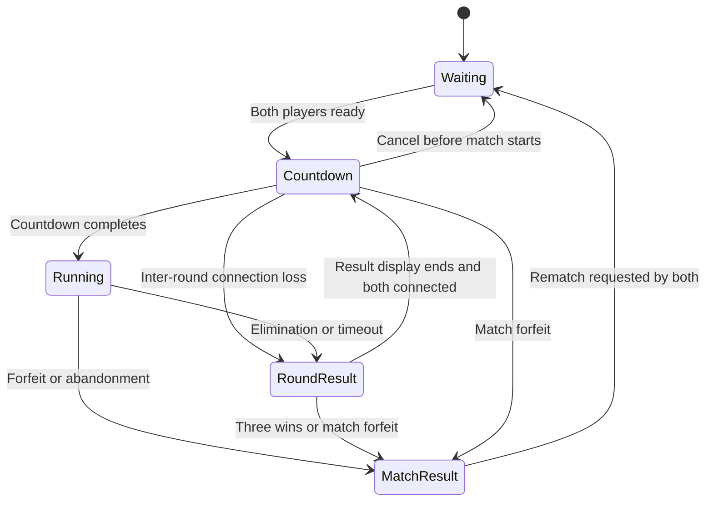

# Grenadiers Classic Bomberman Rules Specification

Status: **draft for discussion**. This is a gameplay design, not a report of implemented features.

Grenadiers is a real-time arena game in which players navigate a maze, place timed bombs,
reshape the arena by destroying obstacles, collect upgrades, and avoid explosions. The first
playable version has two human-controlled competitors. The design leaves room for more player
seats, computer-controlled competitors, and a separate campaign with enemy creatures.

## How to read the rules

Three scopes are used throughout:

- **Classic reference:** recognizable historical mechanics, with release-specific examples cited.
- **Initial Grenadiers rules:** a complete proposed two-player survival ruleset. Numerical values,
  collision policies, and tie-breaking rules are design choices for review, not universal historical facts.
- **Extensions:** documented possibilities that are disabled initially. Their inclusion here does
  not authorize implementing all of them in the first milestone.

No single release contains every feature listed. The broad reference is early Bomberman/Dyna
Blaster, with later series mechanics separated. A particular platform release can replace this
reference if exact reproduction becomes the goal. Character art, story, audio, and branding are
outside this gameplay specification; Grenadiers can use its own presentation.

## Classic game structure

The original NES game is a sequence of enemy-filled mazes. Players clear enemies, destroy
brick obstacles, find the concealed exit, and enter it to advance. Concrete obstacles survive
bombs. Touching an enemy or an unprotected explosion is lethal. Hidden items improve abilities.
The manual names eight enemy types. These campaign rules are distinct from competitive arena
survival. [Original NES manual transcription](https://www.world-of-nintendo.com/manuals/nes/bomberman.shtml)

Competitive survival is the multiplayer foundation: opponents have the same basic actions and
try to outlive one another. Bomberman '93 explicitly supports human and computer competitors,
round wins, and draws for simultaneous elimination; its pressure obstacles, starting upgrades,
and timeout behavior are release-specific. Its campaign also includes specialized creatures.
[Bomberman '93 original manual](https://dds.konami.com/games/manual/pcemini/en_Bomber93.pdf)

Later games add different modes and more bomb manipulation. For example, Bomberman Online's
manual describes kicking, carrying/throwing, punching, line placement, bouncing bombs, illness
items, and several alternative scoring modes. These are useful extension references rather
than requirements for the initial classic arena.
[Bomberman Online original manual](https://www.digitpress.com/library/manuals/dreamcast/bomberman_online.pdf)

## Vocabulary and world layers

| Term | Meaning |
| --- | --- |
| Match | A series of rounds between a fixed set of player seats under one ruleset. |
| Round | One arena instance, from countdown to a win or draw. |
| Player | A competitor's in-game character, whether controlled by a human or a bot. |
| Mob | A campaign creature with a dedicated behavior pattern; it is not a bot player. |
| Cell | One logical square of the arena grid, identified by integer column and row. |
| Terrain | The permanent floor, boundary, and solid obstacles. |
| Soft block | A destructible obstacle occupying a cell above its floor. |
| Bomb | A temporary entity with an owner, position, fuse, and explosion properties. |
| Flame | A temporary damaging area generated when a bomb detonates. |
| Pickup | A collectible ability, upgrade, status effect, or score item. |
| Ruleset | Versioned configuration fixing all enabled mechanics and their parameters. |

Keep terrain, soft blocks, actors, bombs, pickups, and flames in separate logical layers.
A floor cell can contain a player and a flame at the same time. A concealed pickup belongs to
a soft block until revealed. A spawn marker is map metadata, not a special kind of floor.

## Modes and objectives

| Mode | Objective and life cycle | Scope |
| --- | --- | --- |
| Two-player survival | Eliminate the opponent; one lethal hit removes a player for the round. | Initial |
| Multiplayer free-for-all | Last survivor among three or more seats wins. | Extension |
| Team survival | Last team with a living member wins; friendly-fire policy is explicit. | Extension |
| Bots in survival | Replace some human controllers with AI using the same player rules. | Extension |
| Campaign | Defeat required mobs, reveal an exit, and reach it before the stage ends. | Extension |
| Cooperative campaign | Players share campaign objectives; lives, revives, and friendly fire need a dedicated profile. | Extension |
| Score or objective arena | Score kills, paint cells, collect objectives, or hold territory; respawning may be enabled. | Extension |
| Training | Controlled maps, optional invulnerability, and repeatable scenarios without ranked results. | Extension |

Campaign progression, score multipliers, bosses, passwords/saving, continues, and bonus stages
must not silently become survival rules. In survival, killing an enemy is not the victory
condition because the initial arena has no campaign mobs.

## Initial Grenadiers rules and defaults

All values in this section are **proposed Grenadiers settings**, subject to playtesting.
They describe one coherent baseline rather than exact timing from a historical cartridge.

| Setting | Proposed value |
| --- | --- |
| Competitors | Exactly two humans; no bots, mobs, spectators joining seats, or teams yet |
| Match victory | First player to win three rounds |
| Draw | No round-win point; start another round with reset state |
| Ready countdown | 3 seconds, with gameplay commands disabled |
| Normal round duration | 180 seconds |
| Timeout | Draw if more than one player remains; no sudden-death obstacles initially |
| Starting live-bomb capacity | 1 |
| Starting blast range | 2 cells in each cardinal direction, plus the bomb's own cell |
| Starting movement speed | 3 cells per second |
| Bomb fuse | 3 seconds |
| Flame duration | 0.5 seconds |
| Health | One lethal hit at round start; no respawn. The configurable [Heart](heart.md) and [Shield](shield.md) pickups are enabled in new rooms and can add protection |
| Permanent upgrades enabled | Bomb capacity, blast range, movement speed |
| Capacity and range caps | 8 live bombs and 8 cells per ray |
| Speed upgrade levels | 3, 3.5, 4, 4.5, and 5 cells per second |
| Drop rate | 30% of eligible soft blocks conceal an item |
| Item weights | Capacity 40%, range 40%, speed 20% of concealed items |
| Round reset | All bombs, flames, statuses, upgrades, and map destruction reset |
| Simulation | Server-owned fixed update at 60 ticks per second |

A draw can repeat indefinitely; the initial unranked match has no artificial winner chosen by
kills, placement order, network latency, damage dealt, or surviving health. A player can leave
the room between rounds. Ranked scoring and tournament tie-breakers are separate future rules.

## Arena construction and fairness

### Grid and obstacles

The proposed map has a **13 by 11 playable interior**, surrounded by an indestructible border:
15 columns by 13 rows including that border. Coordinates start at the upper-left with `(0, 0)`;
interior columns are `1..13` and rows are `1..11`.

Place permanent pillars at interior cells where both coordinates are even. Give each eligible mirrored cell pair a 65% probability of containing soft blocks, using
the round's deterministic random seed; handle an unpaired center cell once. This
pillar lattice creates corridors and intersections. These dimensions and density are proposed,
not a claim that every classic release uses this layout.

Traverse mirrored pairs in row-major order of their canonical representative (the first
cell of the pair in row-major order). For each eligible pair, draw occupancy with probability
65%; for an occupied pair, draw item presence with probability 30%, then item kind using
40/40/20 capacity/range/speed weights. Mirror both occupancy and content. A configured,
versioned generator must define its exact random algorithm; recording a seed alone is not
a cross-version replay guarantee.

Player spawns are opposite corners: `(1, 1)` and `(13, 11)`. Reserve each spawn and its two
adjacent inward cells as empty floor. Reserve the corresponding mirrored cells as well.
Players start centered on their spawn cells, with no nearby active hazards or bombs.

For the initial competitive map, soft blocks and hidden items are symmetric under a 180-degree
rotation. Assign paired items identically; handle the center cell once. Each round uses a new
seed, and the players swap spawn corners on successive rounds. The pillar layout stays fixed.

### Validation

A valid map must have an intact border, legal spawns, and no item concealed in an
indestructible wall. The underlying floor graph must connect the spawns when soft blocks
are removed. A starting player must have a route to leave the blast of their first bomb;
merely providing one neighboring square is insufficient with a range-two blast. Validate that
at least one legal opening placement has an escape path. This does not make every possible
opening placement safe; planting a bomb in a corner can still be a deliberate mistake.

If a generated map fails validation, use a deterministic symmetric fallback with the same
border, pillars, and spawns, but no soft blocks or hidden items. Record that fallback was used;
do not enter an unbounded random retry loop or let clients repair their own maps.

Generate hidden contents before play rather than rolling when a block breaks. Record the map
seed and generator version for replay. Keep item-generation seeds private during active play;
do not send a seed that lets clients reconstruct concealed items. Neither connected clients
nor future bots receive unrevealed pickup locations merely because the server already knows them.

## Player state and controls

Each player has a stable seat and entity ID, alive/dead state, position, facing direction,
movement intent, upgrade levels, and count of live owned bombs. Future statuses and abilities
are separate fields, not overloaded into appearance or animation states.

| Action | Initial behavior |
| --- | --- |
| Move north, east, south, west | Continuous movement along one cardinal axis at a time. |
| Stop | Releasing movement stops the character; there is no inertia on ordinary floor. |
| Change direction | Turn or reverse when the collision geometry permits. |
| Place bomb | One fresh button press requests one bomb in the cell containing the player's center. |
| Pause/menu | Opens local UI; it does not stop a network round or make the player invulnerable. |
| Leave | Disconnects/forfeits according to the room and disconnect rules below. |

Default keyboard bindings are arrows or WASD for movement, and Space for a bomb. Bindings
should be remappable. Optional future gamepad and touch controls must produce the same
logical actions. No baseline jump, punch, kick, throw, ranged gun, melee attack, or remote
activation exists without an explicitly enabled ability.

Ignore keyboard auto-repeat for bomb placement. A held bomb button does not continuously
plant bombs. If opposite directions are held, the most recently pressed still-held direction
wins; if two perpendicular directions are held, the same rule applies. There is no diagonal
movement bonus. Losing browser focus clears movement locally; server input expiry remains
necessary if that release message never arrives.

### Movement and collision

The server owns positions. Represent coordinates with integers/fixed-point arithmetic;
rendered interpolation does not decide whether a character is hit. Use a square player
collision footprint of side `0.625` cell, centered on the player. The sprite may be larger.
A movement sweep must prevent tunneling through obstacles or flames at every speed level.

Hard walls, borders, soft blocks, and bombs block ordinary movement. Players do not block one
another initially: they can cross or overlap. Pickups, flames, and spawn markers do not block
movement. Flames are dangerous even though they are walkable.

Turning to a perpendicular heading is allowed when the player's center is within `0.25`
cell in classic-v3 (`0.125` cell in historical classic-v1/v2) of that corridor's centerline, including the boundary. Otherwise that intent produces
no movement until a legal heading is requested. Align the perpendicular coordinate only if
the entire swept correction is legal. Alignment consumes the normal movement budget and may
span several ticks; commit the new heading only after alignment completes. Changing the
winning direction or stopping cancels a pending correction. The correction is part of
movement for collision and hazard tests. Solid obstacles can
prevent the correction; flames do not prevent it. Crossing active flame during a permitted
correction kills through the same swept hazard rule as ordinary movement. Assistance must
not silently protect the player from a dangerous turn.

Touching an obstacle boundary stops motion; it does not kill the player. A flame hits when its
cell interior has positive-area overlap with the player's footprint. Merely touching the edge
is not overlap. Check the swept footprint against flames that were active during movement,
then the final footprint against newly created flames later in the same tick.

## Tile and object behavior

The initial arena uses only ordinary floor, hard obstacles, soft blocks, pickups, bombs,
and flames. Other entries below are extensions and require an enabled ruleset.

| Object or terrain | Movement | Bomb and blast behavior | Scope |
| --- | --- | --- | --- |
| Ordinary floor | Passable | Bomb placement allowed; rays cross it. | Initial |
| Boundary or hard pillar | Impassable | Never destroyed; stops a ray before that cell becomes flame. | Initial |
| Soft block | Impassable normally | First ordinary blast destroys it and stops that ray. | Initial |
| Concealed pickup | Inaccessible under its block | Becomes pending when the block is destroyed; reveal waits for flames to clear. | Initial |
| Exposed pickup | Passable; collected by eligible player | Existing exposed item is destroyed by a blast; it does not shield cells beyond it. | Initial |
| Stationary bomb | Blocks movement except temporary overlap grace | Incoming ray triggers it; baseline ray stops at that bomb cell. | Initial |
| Flame | Passable but lethal | Can trigger newly placed or moved bombs; overlaps other flames. | Initial |
| Exit or objective gate | Passable when enabled | Campaign objective; blasting response is release/ruleset-specific. | Extension |
| No-bomb floor | Passable | Rejects placement; whether it stops moving bombs is a separate property. | Extension |
| Conveyor | Adds forced movement | Specify affected players, mobs, and bombs; it does not inherently extend blast range. | Extension |
| Ice or slippery floor | Changes braking/turning | Bomb sliding requires a separate explicit policy. | Extension |
| Warp portal | Transfers eligible occupants to its paired exit | Requires exit occupancy, cooldown, facing, and moving-bomb rules. | Extension |
| Gate or rotating door | Passability changes by state/direction | State transitions must account for blocked exits and bombs. | Extension |
| Water, pit, lava, or void | Map-defined forbidden area or hazard | Decide whether bombs sink, remain, explode, or cannot enter. | Extension |
| Moving or regenerating block | Time-dependent obstruction | Must specify crushing, regeneration under occupants, and blast obstruction. | Extension |
| Multi-hit block | Blocks movement | Needs a hit counter and a rule for simultaneous hits. | Extension |
| Falling pressure block | Permanently removes usable space | Crushes occupants under the sudden-death policy. | Extension |
| Switch or trigger | Activates map mechanism | Define eligible activators, reset time, and whether fire activates it. | Extension |

Bomberman '93 provides historical examples of portals, bomb-prohibiting tiles, conveyors,
and rotating doors. The extension policies above remain Grenadiers decisions.
[Manual](https://dds.konami.com/games/manual/pcemini/en_Bomber93.pdf)

## Bomb placement and ownership

A placement request succeeds only while the round is running and the player is alive.
The target is `floor(x), floor(y)` in cell units; cell boundaries use the cell to the east/south.
The target must be floor with no soft block, hard wall, existing bomb, or placement prohibition.
The player must have a free live-bomb slot. An exposed pickup does not prevent placement.

Bomb capacity is a concurrent limit, not ammunition. A capacity of three permits three
undetonated owned bombs. There is no ammunition pool to refill. A failed request consumes
nothing and must not silently plant a bomb later after conditions change.

Movement resolves before placement in the same tick. First discard requests that individually fail eligibility. If both remaining eligible requests
target the same empty cell in that tick, reject both; neither wins through entity iteration
order. An invalid request from an out-of-capacity player cannot deny a valid opponent placement. Placements
in different cells resolve together. Slots released during this tick's later explosions become
available for placement on the following tick.

When planted, a bomb captures its owner's current range, bomb type, fuse modifiers, and owner
ID. Later pickups do not upgrade existing bombs. The fuse begins on the placement tick; a
normal bomb placed at tick `t` detonates at `t + 180`, unless triggered earlier.

### Stepping away from a newly planted bomb

Every player whose footprint overlaps the newly planted bomb cell receives a temporary
collision exemption for that specific bomb. They can move away without being trapped inside it.
The exemption ends as soon as their footprint fully clears the cell; re-entry is then blocked.
It does not permit passing through another bomb or through a wall. This also covers two
players standing together when one plants a bomb.

A bomb belongs to its placer for capacity and attribution even after the placer dies or leaves.
Kicking or throwing, if enabled later, does not transfer ownership by itself. Capacity releases
exactly once when the bomb detonates or is explicitly removed by a special map rule.

## Explosions and chain reactions

### Ordinary blast geometry

A bomb produces flame in its own cell and in four straight rays: north, east, south, and west.
Range is the maximum number of cells beyond the center along each ray. Range two therefore
covers up to nine cells on unobstructed floor: one center plus two in each of four directions.
There is no diagonal spread, flood fill, blast around corners, or circular damage radius.
An unobstructed range-two footprint is:

```text
..*..
..*..
**B**
..*..
..*..
```

`B` is the bomb's cell (also flame), `*` is another flame cell, and `.` is unaffected floor.

Process a ray one cell at a time, checking obstruction layers in this precedence order:

1. Outside the map or into a hard obstacle: stop; that obstacle cell is not flame.
2. Into a soft block: mark its destruction, add flame in its cell, and stop the ray.
3. Into another bomb: add flame, schedule that bomb to detonate this tick, and stop this ray.
4. Otherwise, add flame and continue if range remains. Players, exposed items, and existing
   flame do not stop the ray; apply their relevant effects.

The floor underneath a block or bomb does not bypass its obstruction test.

The other bomb emits its own full-range explosion when processed. A ray is not simply
extended by the remaining range of its triggering bomb. A bomb triggered from the east still
explodes in all four cardinal directions.

### Simultaneous resolution

Collect all due bombs and bombs intersecting existing flames, then compute the complete
chain reaction against one terrain-and-bomb occupancy snapshot for that tick. Every soft
block present in that snapshot stops every ordinary ray that reaches it, even if another ray
has already marked it for destruction. Apply removals after the chain is fully determined.

Maintain a set of scheduled/detonated bomb IDs. Each bomb explodes once, produces one logical
event, and releases one capacity slot. The result must be unchanged if the server stores
entities in a different order. Bound work by the number of live bombs and arena cells.

For example, two bombs on opposite sides of one soft block both stop at it when they explode
together. Neither explosion passes through the opening created by the other in that same
tick. On a later tick, the now-open floor permits a new explosion to pass.

### Persistent flames and hidden items

Flames are active on the half-open interval `[startTick, endTick)`. An ordinary explosion at
`t` is dangerous through `t + 29` and expires at `t + 30`. Overlapping flames remain dangerous
until the latest contributing expiry. Their visual animation cannot shorten the hazard.

Flames do not repeatedly propagate along their rays on later ticks. However, a bomb placed
into an already burning cell detonates in that same placement tick. Extending a flame's
lifetime does not restore its destroyed block or recreate destroyed items.

An item concealed by a destroyed block becomes pending. It is revealed only after all flames
on that cell have cleared. The revealing blast does not burn this pending item. Any already
exposed item touched by flame is destroyed, with no upgrade awarded. No initial item respawn,
random replacement, or guaranteed reward exists after destruction.

## Damage, elimination, and round results

Ordinary flames kill any unprotected player they overlap, including the bomb owner. There is
no blast resistance, reduced self-damage, friendly ownership exemption, or damage falloff.
Every cell of a flame is equally lethal. Fire is the initial mode's only damage source.

All same-tick damage resolves before victory. A player who crosses an existing flame during
movement dies even if their final position is safe. They cannot plant a bomb or collect an
item after that crossing. A player killed by a newly created blast may already have planted
a valid bomb earlier in that tick; that bomb remains and can participate in the chain.

A dead player's sprite may animate, but their gameplay entity is no longer alive. They cannot
move, block others, pick up items, plant bombs, or trigger living-player objectives. Their
existing bombs continue while the round is running.

At the end of a fully resolved tick:

| Living competitors | Outcome |
| --- | --- |
| Two | Continue, unless the round deadline has been reached. |
| One | Award that player one round win. |
| Zero | Draw; award no round win. |

When the deadline is reached, resolve that tick normally before applying a timeout draw to a
still-contested round. A sole survivor at the deadline still wins. After finalizing a result,
freeze gameplay and show the result; a bomb scheduled for a later tick cannot overturn it.
This explicit immediate-finalization policy can be replaced by a separately specified
end-of-round grace period, but the two policies must never be mixed.

Survival does not require kill credit. If a player destroys themselves, the other player can
win without having placed a bomb. Attribution and statistics must not alter the survival result.

## Upgrades and temporary effects

### Initial enabled items

| Item | Effect | Cap and collection at cap |
| --- | --- | --- |
| Extra bomb capacity | Adds one concurrent bomb slot. | Cap 8; collecting at cap consumes the item without increasing capacity. |
| Longer flame | Adds one cell to each ray of bombs placed afterward. | Cap 8; collecting at cap consumes the item. |
| Faster movement | Advances one level in the speed table. | Cap 5 cells/second; collecting at cap consumes the item. |

Upgrades last until the round resets. They do not survive into the next survival round.
The arena UI must distinguish **available bomb slots** from **maximum capacity**, and blast
range from the apparent size of the sprite. Existing bombs retain their placement-time values.

At the collection phase, a surviving player qualifies when their final center lies in the
exposed item's cell. Merely crossing an item earlier in the tick does not collect it. A bomb
in that cell does not prevent collection. If multiple living players qualify, compare their
final centers and choose the one closest to the item center. Exact ties use a round-seat priority that alternates between players each
round. Collect once and remove the item once. Cosmetic pickup animations cannot grant it twice.

### Optional abilities and pickups

These are extension concepts. Durations, caps, compatibility, and controls must be specified
in a dedicated ruleset before enabling them.

| Ability | Behavior to implement if enabled | Important interaction |
| --- | --- | --- |
| Kick | Move a grounded bomb along a cardinal corridor until blocked or stopped. | Define speed, stop input, actor collision, portals, and whether moving bombs block rays. |
| Punch | Propel an adjacent bomb across cells. | Define landing search, obstacle overflight, map edges, and an occupied landing cell. |
| Carry and throw | Pick up a bomb, carry it, then throw in facing direction. | Explicitly choose whether the fuse continues, pauses, or resets while held. |
| Line placement | Place multiple bombs along facing direction up to remaining capacity and obstacles. | Each bomb is a real entity; partial success and item occupancy need precise rules. |
| Bomb pass | Walk through grounded bombs. | Does not imply fire immunity or permission to place a second bomb in an occupied cell. |
| Soft-block pass | Traverse destructible obstacles. | Define damage while inside a block; never imply hard-wall pass. |
| Flame protection | Prevent fire damage for a fixed interval. | Does not automatically protect from mobs, pits, or pressure blocks. |
| General invulnerability | Prevent specified damage classes temporarily. | Enumerate classes; define expiry during overlap with a live flame. |
| Shield or extra hit | Consume a charge instead of dying. | Needs hit de-duplication and a post-hit grace interval. |
| Extra life | Add a campaign life. | Has no automatic meaning in elimination survival. |
| Clock or freeze | Freeze selected actors or the campaign timer. | Does not implicitly freeze bombs, fire, or network simulation. |
| Maximum fire | Set flame range to the configured cap. | Still respects normal obstruction unless piercing is independently enabled. |
| Score or collectible | Increase campaign score or satisfy an objective. | Does not increase combat power unless explicitly defined. |
| Mount | Add a rideable companion with a separate hit/ability state. | Specify dismount, protection, movement, and whether abilities survive mount loss. |

### Negative status items

Optional skull/illness items can impose forced high or low speed, reversed directional input,
forced motion, automatic bomb placement, blocked bomb placement, reduced flame range, or
changed fuse length. Some releases include contact transmission. These effects are not all
present in all versions. See the release-specific sickness descriptions in the
[Bomberman Online manual](https://www.digitpress.com/library/manuals/dreamcast/bomberman_online.pdf).

For Grenadiers, an enabled illness profile must define its duration, acquisition probability,
replacement/stacking rule, contagion contact test, and reset behavior. Treat an illness as a
temporary overlay on permanent upgrades so expiry restores the underlying values. Fuse and
range penalties are captured by newly planted bombs, not applied retrospectively to every bomb.

A contagious illness must not bounce endlessly between two overlapping players in one tick.
Record transmission eligibility and an immunity/cooldown interval. Illness generation and
transmission must be deterministic and visible enough for the player to understand the effect.

## Weapon and bomb extension catalog

The ordinary timed bomb is the entire initial weapon system. The flame is its damage effect;
kicking, punching, and throwing are manipulation abilities, not separate ranged guns.

| Bomb concept | Distinct behavior | Additional decisions before implementation |
| --- | --- | --- |
| Ordinary timed bomb | Fixed fuse and cross-shaped blast. | Fully specified above. |
| Remotely triggered bomb | Owner chooses detonation time. | One versus all bombs, ordering, safety timeout, and behavior after owner death/disconnect. |
| Piercing bomb | Rays can continue through destructible blocks. | Whether each block consumes range; whether other bombs still stop the ray. Hard walls remain distinct. |
| Large or power bomb | Larger blast extent or alternative footprint. | Exact cell mask; never infer a circular physical explosion from a large animation. |
| Bouncing bomb | Changes motion after kick/throw or impact. | Deterministic bounce choice, collision priorities, fuse behavior, and stopping conditions. |
| Mine or contact bomb | Activates from proximity/contact after arming. | Trigger eligibility, owner grace, visibility, blast mask, and timeout. |
| Seeking or pursuing bomb | Moves toward a target. | Acquisition rules, turn frequency, collision, and telegraphed movement. |
| Special stage projectile | Map or boss attack that creates hazards. | Origin, travel, timing, obstruction, and which damage classes apply. |

This catalog deliberately separates “the game family has explored an idea” from an exact
historical specification of that idea. Remote detonation is documented in the NES controls;
bouncing and manipulation examples are documented in Bomberman Online. Mine, seeking, and
boss-projectile entries are future design categories, with no promised release-equivalent
behavior or inclusion in Grenadiers.

## Mobs and campaign creatures

### Historical references and limitations

The NES manual names **Valcom, O'Neal, Dahl, Minvo, Ovape, Doria, Pass, and Pontan**. Names,
spellings, artwork, pursuit behavior, and movement speeds vary across ports and translations.
Do not equate every similarly named creature across games or invent frame-exact AI from
its appearance. A faithful roster requires selecting the target release.
[Original manual transcription](https://www.world-of-nintendo.com/manuals/nes/bomberman.shtml)

For a qualitative NES-era reference, a player-observation guide describes the following
patterns. These are useful recognition guides, not frame-exact algorithms or verified behavior
for every Dyna Blaster port.

| NES guide name | Qualitative behavior |
| --- | --- |
| Valcom | Slow patrol with occasional direction changes. |
| O'Neal | Faster movement and more tendency to approach the player. |
| Dahl | A faster pursuit-style threat. |
| Minvo | Fast back-and-forth movement. |
| Ovape | Very slow; passes through brick obstacles. |
| Doria | Moderate speed; passes through brick obstacles. |
| Pass | Fast, more aggressive pursuit. |
| Pontan | Extremely fast; described as able to pass through walls. |

“Wall passing” needs release-specific verification before implementation; it must not
accidentally grant passage through indestructible arena boundaries.
[NES player-observation guide, enemies section](https://gamefaqs.gamespot.com/nes/563390-bomberman/faqs/14622)

Bomberman '93 documents useful additional patterns: Maround drifts; Rocky has a protected
settled state; Batatak bypasses boulders; Banbo requires two hits; Bombawan retaliates when
attacked; and Buryboy cannot be damaged while buried. These are campaign enemy patterns,
not multiplayer bot skill levels.
[Original manual](https://dds.konami.com/games/manual/pcemini/en_Bomber93.pdf)

### Proposed reusable enemy behaviors

The following are **Grenadiers campaign templates**, not claims to reproduce the NES AI.
They let a later campaign express the familiar enemy families precisely.

| Template | Movement and decisions | Damage and obstacle rules |
| --- | --- | --- |
| Drifter | Choose a seeded random legal direction at intersections; keep direction between decisions; reverse at dead ends. | One fire hit; cannot cross soft blocks or bombs. |
| Watcher | Drift until a player shares an unobstructed corridor, then pursue that corridor until blocked. | One hit; does not obtain omniscient hidden information. |
| Sprinter | Alternate a clearly telegraphed idle state and a fast straight run. | One hit; fast movement still uses swept collision. |
| Soft-block walker | Choose paths across floor and soft-block cells, but never hard walls. | One hit; define exposure when the containing block is destroyed. |
| Hunter | Recompute a path toward a living player at fixed decision intervals. | Path cost respects the template's actual traversal abilities. |
| Armored creature | Expose a vulnerable state between protected phases. | Hits in the protected state do nothing; separate damaging contacts are needed. |
| Burrowing creature | Alternate invulnerable buried traversal and visible vulnerable emergence. | Telegraph emergence; buried collision and contact damage are explicit. |
| Retaliator | Upon a valid hit, emit a specified hazard or spawn attack before dying or changing phase. | Resolve retaliation within the same deterministic event system. |
| Bomber creature | Move and place bombs under its own restricted policy. | Its bombs obey the configured geometry, ownership, and capacity rules. |
| Boss | Cycle through telegraphed attacks, movement, vulnerability, and phase transitions. | Has explicit hit points and hit cooldown; fire lingering on it cannot remove every hit point instantly. |

Every implemented mob must supply a data sheet: movement speed, decision interval, legal
terrain, bomb interaction, target selection, sight range, hit points, invulnerable states,
contact damage, score, spawn/death behavior, animation cues, and seed usage. “Moves randomly”
and “chases the player” alone are insufficient implementation rules.

For multi-player PvE, select the nearest reachable living target at a decision boundary;
resolve equal distances using stable, seeded tie-breaking. Define whether monsters collide
with one another, whether they avoid fire, and whether they can consume or destroy items.
Do not assume an enemy that crosses soft blocks can also cross bombs or hard walls.

A later campaign profile must choose starting lives, retained upgrades after death, enemy
respawn policy, exit unlock conditions, damage protection after respawn, stage timeouts,
boss-stage differences, and any punishment for bombing a revealed exit. None of these
inherit the survival defaults automatically.

## Bot competitors

A bot occupies a player seat and obeys the same movement, bomb capacity, collision, timing,
pickup, death, and victory rules as a human. It is not a campaign mob with privileged movement.
The first release does not require bots.

Future bot decisions should prioritize survival, then safe opportunity: detect impending
hazards, find a reachable safe destination, avoid trapping itself, collect useful exposed
items, remove useful blocks, and pressure opponents. A bomb placement needs a predicted
escape route accounting for its fuse and possible chains; checking only the current flame
cells is insufficient.

Model time as well as space: a cell safe now may burn when a bomb detonates, and a route may
close behind another placed or moving bomb. Difficulty should vary decision frequency,
reaction delay, prediction horizon, or imperfect tactical choices. It should not secretly
grant faster movement, extra bombs, knowledge of concealed pickups, or immunity.

Bots receive the same public arena information as players, with an explicit policy for any
fog of war. Use deterministic decision schedules and seeded tie-breaking where repeatable
simulation is required. Human and bot commands enter the same validation and action path. The
[single-player versus CPU proposal](single-player-cpu.md) describes a recommended implementation.

## Optional sudden death and arena hazards

Sudden death is disabled in the initial ruleset. If enabled later, define a warning time,
start tick, hazard schedule, affected cells, and a terminal condition before shipping it.
One possible Grenadiers profile progressively replaces cells with hard pressure blocks in a
precomputed inward spiral, with a visible warning before each placement.

A fully specified pressure-block profile must decide whether a block crushes actors instantly,
erases items, deletes bombs without an explosion or triggers them, extinguishes flames, and
can land on a permanent pillar. Its schedule must not depend on client animation completion.
Compute simultaneous crushing deaths before victory, just like simultaneous flame deaths.

Other optional hazards include timed floor fire, periodically closing gates, moving barriers,
falling platforms, and boss attacks. Each needs a schedule/state machine, visible warning,
collision footprint, lethal interval, and damage class. Water or lava artwork alone must not
change traversal rules.

## Round and match life cycle

A room contains seats and readiness state. The initial game starts only when both human
players are present and ready. Lock ruleset and map configuration before countdown.
A match starts when its first round enters Running. Leaving or disconnecting before that
point cancels the initial countdown without recording a forfeit. After the match starts,
inter-round holds preserve scores and the match-level departure rules apply.



After a round result, show the winner/draw and updated score for at least three seconds.
Initial readiness consents to the full match: the next countdown starts automatically once
that display interval ends and both players are connected, without another ready click.
During a reconnect grace, reserve the vacant seat and hold the result state instead. If
connectivity is lost during an inter-round countdown, cancel that countdown and hold the
last result until reconnection or forfeit. Never reset the match score merely because the
next round is waiting for reconnection.

A rematch starts a new match, with new scores and a fresh seed sequence. A player cannot join an active
round by opening another socket. Reconnecting to an existing authenticated seat is a separate
operation from claiming a vacant seat.

If a participant explicitly abandons an unfinished match, record a forfeit rather than fabricate
ordinary round wins or kills. Two explicit departures assigned to the same server tick produce
an abandonment with no winner. The other participant is the match winner by forfeit if still
participating. An aborted server process produces an interrupted match, not a fabricated victory.

## Disconnects and browser behavior

For the proposed initial network profile, allow ten seconds (600 server ticks) of
reconnection grace during an unfinished match. Its deadline advances on a match-level clock
through Running, RoundResult, and inter-round Countdown/holding states. On transport loss,
clear movement/action input; keep the character, bombs, fuses, and hazards in a running round.
Other players continue normally. A disconnected character remains vulnerable and can die
before grace expires; that death does not cancel the match-level deadline.

Reconnection before the player's own deadline restores the same reserved seat and supplies
the latest authoritative snapshot. It does not rewind the round, reset bombs, grant
invulnerability, or replay buffered bomb presses. An expired seat cannot resume control.

Apply these deadline rules to an unfinished match:

- If one player's grace has expired and the opponent is connected, the expired player forfeits.
- If both are disconnected, wait while either still has unexpired grace. Expiry of the first
  deadline alone does not award the other disconnected player a win.
- If the still-eligible opponent reconnects while the other seat is expired, award that
  returning opponent a match win by forfeit.
- If both deadlines expire without reconnection, record abandonment with no winner.

Evaluate same-tick gameplay deaths and round scoring before disconnect outcomes. Only a
finalized match result suppresses a pending forfeit: winning a nonfinal round does not
cancel it, while reaching the configured win target (three by default) ends the match first. Preserve both the
actual round result and the distinct match-forfeit result. These checks execute even when
that tick transitions out of Running.

A hidden browser tab or local menu is not an online pause. Resuming a suspended tab must
resynchronize rather than fast-forward a private simulation. Spectating, host migration,
ranked disconnect penalties, and replacing disconnected humans with bots are future features.

## Authoritative timing and event order

A monotonically advancing server tick drives every match state, including countdowns and
result/holding periods. A round's local Running updates are numbered 1 through 10,800; resolve
update 10,800 and then apply timeout, for exactly 180 seconds at 60 updates per second.
Bomb deadlines use the corresponding absolute server tick, independent of local round labels.

The fixed tick is authoritative; wall-clock duration only drives tick scheduling. Use integer
tick deadlines for fuses, fire, statuses, countdowns, and reconnect grace. Keep a rational or
integer residual accumulator for speeds that do not divide evenly into ticks. Avoid floats
whose rounding changes collision outcomes across platforms.

For each running tick, use this order:

1. Expire hazards and statuses whose end tick has arrived; reveal pending items on now-clear cells.
2. Read accepted, sequenced commands for this tick. Reject duplicates and unauthorized seats.
3. Move living players; record lethal swept contact with existing flames and eliminate those players.
4. Resolve valid placement requests from remaining living players; snapshot bomb properties.
5. Collect fuse-expired and flame-triggered bombs and resolve the complete chain against one snapshot.
6. Apply bomb removals, soft-block destruction, flame creation, and exposed-item destruction.
7. Apply newly created hazards to all remaining living actors; resolve all deaths together.
8. Collect exposed items for survivors; update persistent upgrade levels.
9. Determine elimination results, then timeout, then any still-relevant disconnect forfeits.
10. Emit the authoritative state and events for the completed tick.

The round deadline is a tick included in this sequence; timeout is evaluated at step nine.
State-changing transitions outside `Running` have their own countdown/result deadlines.
Local rendering may interpolate positions but must not change the above order.

Assign stable entity IDs and deterministic iteration/tie-breaking. Record the ruleset version,
map-generator version, seed, starting seats, accepted commands, and tick-assigned external
lifecycle events for reproducible replays. Lifecycle events include readiness, start, disconnect,
reconnect, explicit departure, and administrative termination.
Separate cosmetic randomness from gameplay randomness. The same accepted command and lifecycle log must produce the same authoritative result
regardless of rendering frame rate or map storage order.

## Networking responsibilities and limits

The browser sends intentions, not positions, damage claims, item ownership, or victory claims.
The server validates seat ownership, input sequence, allowed actions, and message bounds.
Give one-shot bomb actions stable IDs so retries cannot create additional bombs.

Proposed transport behavior: refresh held movement at least every 100 milliseconds; expire
unrefreshed movement after 250 milliseconds. Missing or late bomb actions are not retroactively
inserted into completed ticks. Accepted commands are assigned to a server tick in order;
future client prediction cannot alter that authoritative assignment.

Snapshots should contain the tick, round state, public terrain/destruction, living/dead actors,
bombs and their visible timing, flames, exposed pickups, and scores. Events include placement,
detonation, destruction, pickup, elimination, and round/match result. Reconnection requires a
full snapshot, not an assumption that every prior event was received.

The existing hello/ping/pong WebSocket is only scaffold diagnostics. A gameplay protocol must
be designed and versioned separately before implementation. Authentication, room admission,
input budgets, snapshot cadence, prediction, reconciliation, and interpolation are technical
requirements to specify next; they are not already provided by this gameplay document.

## Player feedback and presentation

The view must communicate the same facts the simulation uses: walkable terrain, bomb locations,
active fire, destructible obstacles, exposed items, each player's identity, timer, bomb slots,
range, and relevant speed/status changes. Do not rely solely on player color for identity.

Bombs need readable fuse progress. Fire starts and stops with authoritative hazard timing,
not a separate animation timer. Destruction, chain reactions, pickups, and deaths should have
distinct visual/audio cues. Audio can be muted without losing essential warnings. Optional
hazard warnings need visible equivalents, and flashing effects should offer reduced intensity.

The result screen distinguishes win, draw, forfeit, and interrupted match. It must not display
an inferred “you killed the opponent” when the actual event was self-elimination or disconnect.
No particular sprite sheet, tile pixel size, camera renderer, music, or visual theme is required
by these rules. A renderer must display an arena large enough that opponents cannot hide
outside the visible competitive playfield.

## Statistics and attribution

Durable storage is optional for initial play. Later records can store ruleset version, map
seed, participants, round/match results, duration, placements, pickups, and elimination causes.
Live match state stays with its authoritative in-memory owner.

For future statistics, a chained bomb retains its original owner; the triggering bomb does
not automatically steal credit. If multiple blast sources overlap a lethal hit, preserve the
source set and use a separately documented primary-credit rule. Self-eliminations and forfeits
remain distinct. None of these attribution details change who survives or wins a round.

## Acceptance scenarios

These are future behavioral tests, not a claim that the current repository already implements them.

| ID | Scenario and required result |
| --- | --- |
| RULE 01 | A range-two bomb in clear floor affects exactly its center and eight ray cells. |
| RULE 02 | A hard pillar stops a ray and is neither destroyed nor made into a flame cell. |
| RULE 03 | A soft block is destroyed and stops the ray that hit it. |
| RULE 04 | Two simultaneous blasts hitting opposite sides of one soft block cannot pass through it. |
| RULE 05 | A three-bomb chain detonates entirely within one tick, each bomb exactly once. |
| RULE 06 | Permuting bomb storage order leaves destruction, flames, deaths, and results unchanged. |
| RULE 07 | A bomb at capacity prevents another placement without consuming any resource. |
| RULE 08 | The placer can step away from a new bomb, then cannot re-enter without a pass ability. |
| RULE 09 | Two overlapping players can both leave a bomb placed underneath them. |
| RULE 10 | Two eligible same-tick placement requests for one cell are both rejected. |
| RULE 11 | A range pickup changes later bombs without changing a bomb already planted. |
| RULE 12 | A bomb placed in active flame detonates in the placement tick. |
| RULE 13 | Repeated trigger hits do not release a bomb's capacity slot more than once. |
| RULE 14 | A flame remains hazardous on its final active tick and is safe on its expiry tick. |
| RULE 15 | Overlapping flames expire only after the last contributing flame expires. |
| RULE 16 | Swept movement through an existing flame kills even if the final cell is safe. |
| RULE 17 | Maximum-speed movement and turn assistance cannot tunnel through an obstacle. |
| RULE 18 | A concealed item survives its revealing blast and appears only after fire clears. |
| RULE 19 | An exposed item hit by flame disappears rather than granting a pickup. |
| RULE 20 | Damage resolves before collection; a dying player cannot gain an item to escape that death. |
| RULE 21 | Both players dying in one tick produces a draw with no score increment. |
| RULE 22 | One survivor after the complete chain gets a win; no mid-chain winner is announced. |
| RULE 23 | A bomb planted by a player killed later that tick still affects the chain normally. |
| RULE 24 | Future scheduled bombs cannot overturn a finalized round result. |
| RULE 25 | A contested round reaching its deadline draws after that tick's damage resolves. |
| RULE 26 | Releasing a movement key stops intent; keyboard auto-repeat does not create extra bombs. |
| RULE 27 | Duplicate/replayed action IDs cannot create extra bombs or pickups. |
| RULE 28 | Disconnect clears input but leaves the character and planted bombs vulnerable and active. |
| RULE 29 | Reconnect restores the same seat without rewinding time or replaying buffered actions. |
| RULE 30 | A first-to-three winner ends the match; a draw resets the round without awarding a point. |
| RULE 31 | Identical ruleset/generator versions, seed, commands, and lifecycle events reproduce the same states. |
| RULE 32 | Revealed snapshots do not leak concealed item locations to humans or bots. |
| RULE 33 | A generated spawn has a real escape route from its first blast. |
| RULE 34 | Symmetric map generation and alternating spawn seats do not depend on player join order. |
| RULE 35 | Staggered dual disconnects end in abandonment if both grace periods expire without a return. |
| RULE 36 | Grace expiry in RoundResult still terminates an unfinished match under the forfeit rules. |
| RULE 37 | A second round win does not cancel an expiring forfeit; a third round win finalizes the match first. |
| RULE 38 | Turning assistance across an active flame kills through the normal swept hazard rule. |
| RULE 39 | A surviving player can collect an exposed item beneath a newly planted bomb. |
| RULE 40 | An item revealed at tick start can be destroyed by a new blast later that tick. |
| RULE 41 | A round resolving no elimination executes exactly 10,800 Running updates before timeout. |
| RULE 42 | An ineligible placement request cannot cause a valid opponent placement to be rejected. |

Extension-specific tests must cover their additional interactions before enabling them. For
example, kick plus conveyor plus portal is a combined behavior, not three isolated features.

## Delivery stages and decisions still needed

The [implementation and release plan](implementation-plan.md) maintains detailed milestones,
dependencies, release scope, and test ownership. The stages below summarize the gameplay sequence.

1. **Review the reference and baseline.** Confirm the historical anchor, proposed movement feel,
   values, timeout/result policy, map dimensions, and which items belong in the initial release.
2. **Implement local deterministic rules.** Map validation, movement, collision, bombs, explosions,
   items, damage, and round outcomes, with the acceptance scenarios above.
3. **Implement online two-player rounds.** Room admission, input ownership, snapshots, reconnect,
   countdown/result UI, and real two-browser end-to-end tests.
4. **Playtest and tune.** Evaluate movement, turning, fuse/range/speed combinations, spawn fairness,
   map density, latency, and match duration before treating defaults as stable.
5. **Expand deliberately.** Add bots/more players, advanced bomb abilities, special maps, or a
   campaign as separate ruleset increments, each with interaction tests.

The two-player survival loop is the first milestone. Mobs and campaign progression are fully
separate expansion work; their appearance in the reference catalog does not require them to
ship before the initial playable game.
