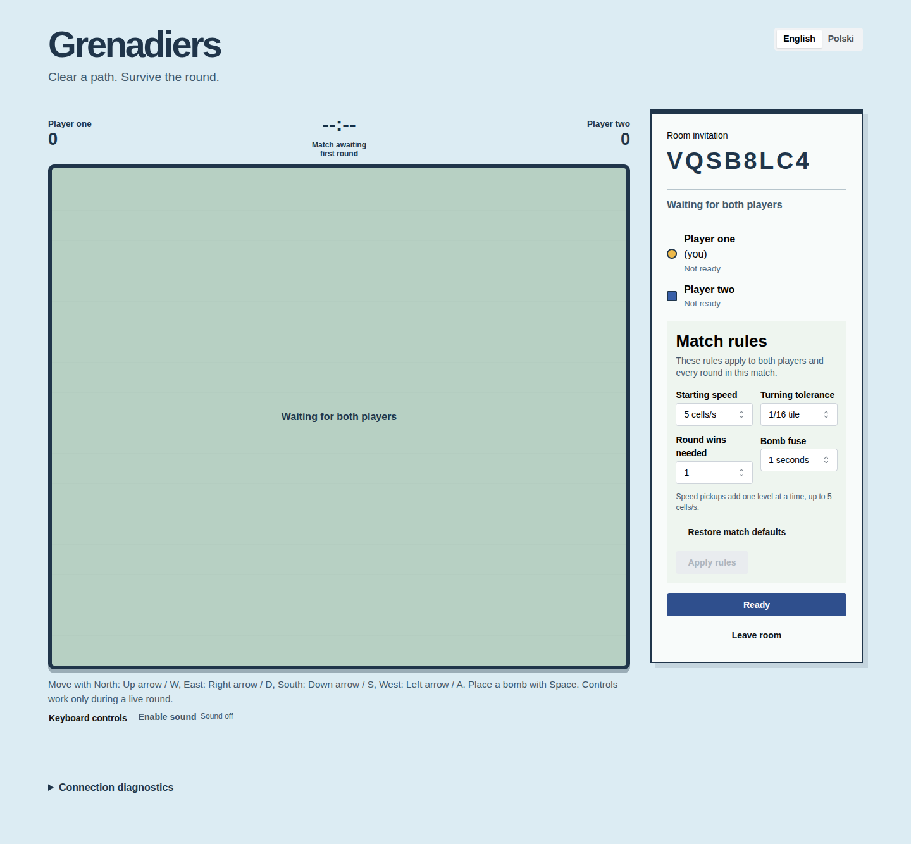
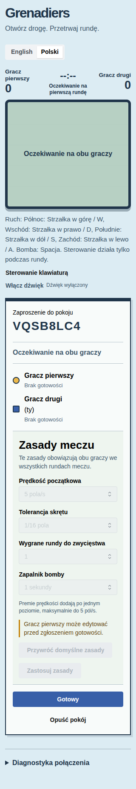

# Game and feature acceptance history

This archive preserves dated release, native-acceptance, artifact-identity, audit and screenshot
fingerprint records removed from current gameplay guides. Current behavior and reproduction
instructions live in the linked guides; this file is historical evidence, not a current release
gate or status page.

## Expanded item delivery sequence

Current guide: [Expanded item implementation](../game/expanded-items.md).

Published [v0.3.47](https://github.com/liveweird/grenadiers/releases/tag/v0.3.47) adds opt-in [Oil Barrel](../game/oil-barrel.md)
arena objects and completes all 22 requested item types. Gameplay v11 is active; older clients
must reload. Publication and exact-image local promotion are complete. ART-ATLAS follows; see
[verification](../verification.md) for accepted scope and checks.

## Historical Heart activation checkpoint

At the v0.3.21 checkpoint, the **Heart activation candidate was implemented and locally verified**,
while native release acceptance was still pending. That candidate introduced
Expanded-v5/generator-v2 rooms and gameplay-v8; see [Heart](../game/heart.md). Later candidates added
opt-in [Shield](../game/shield.md), [Golden Flame](../game/golden-flame.md), [Short Fuse](../game/short-fuse.md),
[Short Flame](../game/short-flame.md), [Long Fuse](../game/long-fuse.md), [Reverse Controls](../game/reverse-controls.md),
[Diarrhea](../game/diarrhea.md), [Slow foot](../game/slow-foot.md), [Piercing Bomb](../game/piercing-bomb.md),
[Power Bomb](../game/power-bomb.md), [Remote Bomb](../game/remote-bomb.md), [Landmine](../game/landmine.md),
[Invisibility Cloak](../game/invisibility-cloak.md), [Stopwatch](../game/stopwatch.md),
[Invisible Bombs](../game/invisible-bombs.md), [Teleporter](../game/teleporter.md), [Wall Pass](../game/wall-pass.md),
[Kick](../game/kick.md), [Punch](../game/punch.md), [Bracelet](../game/bracelet.md), and [Oil Barrel](../game/oil-barrel.md) while
retaining Expanded-v5 rules, generator-v2, journal-v2, and their reviewed protocol identities.

At the 21 October 2026 16:47 UTC native acceptance checkpoint, Invisibility Cloak was an
**unreleased source candidate**. Corrected source `1c6724f` and
image `960976c9` pass a fresh 51 Compose plus 51 Kubernetes matrix with zero retries or carried
passes. Independent raw review is clear; all 2,298 payloads are sealed and the 2,299-file durable
copy is byte-verified. The complete 320px HUD proof runs in stable Running and restores 390px
before gameplay. At that checkpoint, PR #84 was draft at earlier head `97a85d4`; both seven-job
candidate workflows, merge/post-merge CI, publication, exact-image promotion and tag CI remained
pending. Thirteen of the 22 requested item types were published, and Landmine v0.3.37 was
published and deployed locally. See [release notes](https://github.com/liveweird/grenadiers/releases)
for current release status. CI retains one image, two complete
browser shards (23 item/default plus 28 classic cases), and the existing 20-minute job limits.

At the 21 October 2026 18:44:23 UTC native acceptance checkpoint, v0.3.39 source `272b950` and
image `9a4dc108` passed a fresh 51 Compose plus 51 Kubernetes matrix with zero retries or carried
passes. Independent raw audit is clear; 2,320 payloads are sealed and the 2,321-file durable copy
is byte-verified. Published v0.3.38 merge `3c210c23` has exact accepted tree `d1dc83fc`; its raw
documentation and capture parent `04c070c5` is integrated into the gameplay-v9 foundation.
Fourteen of the 22 requested item types are published, and v0.3.39 activates no additional item.
At that checkpoint, normalization, candidate and post-merge CI, publication, tag CI and local
promotion remained pending. See [release notes](https://github.com/liveweird/grenadiers/releases)
for current release status.

Status: [Heart](../game/heart.md), [Shield](../game/shield.md), [Golden Flame](../game/golden-flame.md),
[Short Fuse](../game/short-fuse.md) and [Short Flame](../game/short-flame.md) are published through v0.3.29.
The v0.3.30 [Long Fuse](../game/long-fuse.md) increment passes local checks and corrected-source native
acceptance: 32/32 Compose and 32/32 Kubernetes cases, wrapper exit zero, no retries or carried
results. Independent final evidence review and all required CI pass; v0.3.30 is published. Verification
retains the earlier hosted failure and separately named source-specific attempts.
The v0.3.31 [Reverse Controls](../game/reverse-controls.md) increment passes local checks and fresh
33/33 Compose plus 33/33 Kubernetes acceptance. All required CI passes; v0.3.31 is published.
The v0.3.32 [Diarrhea](../game/diarrhea.md) increment passes local checks and independent implementation
reviews and fresh same-image 45/45 Compose plus 45/45 Kubernetes acceptance after the reviewed
startup-readiness correction. Independent final native review, candidate CI and post-merge CI
pass; [v0.3.32](https://github.com/liveweird/grenadiers/releases/tag/v0.3.32) is published. The
original CI counterexample is retained separately. The
v0.3.33 [Slow foot](../game/slow-foot.md) passes local checks and independent implementation reviews and
fresh same-image 46/46 Compose plus 46/46 Kubernetes acceptance after reviewed browser-driver
corrections. All 22 latency cases per target pass; static parity contains 47 scenarios. The whole
wrapper exits zero with no retries or carried passes. Candidate and post-merge CI pass, and
[v0.3.33](https://github.com/liveweird/grenadiers/releases/tag/v0.3.33) is published as a source
prerelease. Its final raw source is integrated into the v0.3.34
[Piercing Bomb](../game/piercing-bomb.md) candidate. Piercing retains its feature and version; repository,
E2E lint, Knip, type checking and 48-scenario parity pass. Fresh same-image acceptance passes all
47 Compose and 47 Kubernetes cases with zero retries. Independent evidence review, candidate CI
and post-merge CI pass; [v0.3.34](https://github.com/liveweird/grenadiers/releases/tag/v0.3.34)
is published as a source prerelease. Its final raw source is integrated into the v0.3.35
[Power Bomb](../game/power-bomb.md) candidate. Power retains its feature and version; local checks and
independent implementation reviews are clear. Fresh same-image acceptance passes all 48 Compose
and 48 Kubernetes cases with zero retries; independent evidence review and the final seal are
clear; both five-job candidate CI runs and the five-job post-merge run pass, PR 81 is merged, and
[v0.3.35](https://github.com/liveweird/grenadiers/releases/tag/v0.3.35) is published as a source
prerelease and its accepted image is deployed locally. The accepted raw source is integrated into the
v0.3.36 [Remote Bomb](../game/remote-bomb.md) candidate. Remote Bomb retains its reviewed one-charge
manual-trigger behavior and passes fresh same-image 49/49 Compose plus 49/49 Kubernetes cases
with zero retries. The raw evidence audit and seal are clear; both five-job candidate workflows
and the post-merge workflow pass all 49 browser cases. PR 82 is merged, [v0.3.36](https://github.com/liveweird/grenadiers/releases/tag/v0.3.36)
is published and its accepted image is deployed locally. Its CI-corrected raw source is integrated
into the v0.3.37 [Landmine](../game/landmine.md) candidate. Fresh same-image acceptance passes all
50 Compose and 50 Kubernetes cases with zero retries; independent raw audit is clear and evidence
sealed. Both candidate workflows and post-merge CI pass five jobs and all 50 browser cases;
PR 83 is merged, v0.3.37 is published and its accepted image deployed locally. Expanded-v5/generator-v2 rooms and gameplay-v8 are retained; see
[verification](../verification.md) and
[release notes](https://github.com/liveweird/grenadiers/releases).
The accepted raw Landmine source is integrated into the v0.3.38 [Invisibility Cloak](../game/invisibility-cloak.md)
source candidate. Its corrected reveal-position driver and private actor/event semantics are
retained. Corrected source `1c6724f` passed fresh 51 Compose plus 51 Kubernetes acceptance with an independent raw audit and durable seal. Those exact-head candidate/post-merge CI, publication and promotion gates subsequently passed for v0.3.38; the accepted parent is integrated above.

At the 21 October 2026 20:56:41 UTC v0.3.40 native checkpoint, corrected [Stopwatch](../game/stopwatch.md)
source `fa25467`, tree `07ac34a8`, and image `ec8604af` passed complete 32,768-mask debug,
release and coverage execution plus fresh 52 Compose and 52 Kubernetes cases, with zero retries
or carried passes. The earlier `bd9d064` attempt is historical and contributes no pass. Independent raw audit is clear and 2,434 payloads are durably sealed; hosted CI, PR/merge, publication, tag verification and promotion remained
pending at this checkpoint. Published v0.3.39 remains the parent and local deployment. Fourteen of
22 item types were published; Stopwatch is the fifteenth source/native-verified type, and seven
requested types remain after it. See [release notes](https://github.com/liveweird/grenadiers/releases)
for current release status.

The v0.3.41 source candidate adds [Invisible Bombs](../game/invisible-bombs.md) as gameplay v9's sixteenth
independent item. The integrated catalog has 65,536 subsets; all earlier mappings and the archived
v8 catalog remain pinned. Prepared-source checks do not establish native acceptance or hosted
release CI for this integrated candidate, and no v0.3.40 acceptance result is carried forward.

Published [v0.3.42](https://github.com/liveweird/grenadiers/releases/tag/v0.3.42) adds
[Teleporter](../game/teleporter.md) as the seventeenth optional pickup while
preserving every v0.3.41 item. Rules version 5, generator version 2 and journal format 2 remain
stable; Teleporter introduces the paired gameplay-v10 contract for its authoritative position
epoch. Its release acceptance and exact-image local promotion are complete; older pending language
in dated checkpoints remains historical.

Published [v0.3.43](https://github.com/liveweird/grenadiers/releases/tag/v0.3.43) adds
[Wall Pass](../game/wall-pass.md) as the eighteenth optional pickup while preserving gameplay v10. Native
source `11d0dc7e39e8e2cafcf70c1548be339f52c740ab` and exact image
`sha256:577abb32958e45912f35a7f6ae68dd624deb6515d2b4d55519942c44436a2a01` complete all 262,144
settings masks in debug, release and coverage plus 55+55 same-image native cases with zero retries
or carry. Independent audit, binding review, durable sealing and post-seal review are clear;
published source `c086f719ea470b9fe24963adef84b5e3bdf3e17a` passes first-attempt candidate, master
and tag CI and is locally promoted on the accepted image.
Corrected source `5dbcd58` adds only the Happy DOM 21.0.4 development-security correction. Its
fresh web and configured security gates pass, and reviewed retained-artifact comparison preserves
the accepted host distribution. Native acceptance remains attributed to source `11d0dc7`; the
eight later published-source changes are documentation only. This is the historical v0.3.43
checkpoint; [v0.3.44](https://github.com/liveweird/grenadiers/releases/tag/v0.3.44) later publishes
Kick as the nineteenth requested item.
This optional track follows the [backlog](../game/backlog.md), shared settings and
pixel-art increments. The historical catalog in [rules](../game/rules.md) is not an implementation
claim. Each activation requires its own reviewed behavior, UI, documentation and acceptance.

The v0.3.19 foundation introduced `core::game::{inventory,effects,damage}` and immutable Actor
inventory, effect and derived-stat access. At that stage, production could not inject items into
State. Both fire checks share the damage gateway; effects/grace expire before movement and new bombs capture derived
range/fuse. Slow-foot exposes an exact speed ratio but does not change movement before activation.
That foundational release enabled no item pickup, equipment action, visible effect, new rules
profile or wire field. Heart activation followed in v0.3.25.

The historical foundation review cleared checked elapsed grace in place of overflow-prone Heart
expiry. Its integrated gates passed 334 core tests, 163 server tests, two doctests and 230 web tests;
four dedicated performance profiles were intentionally ignored. Rust line coverage was 94.21%
above the unchanged 80% floor. Dependency audits and strict Kubernetes schemas passed. The same
image passed 24/24 scenarios through Compose and 24/24 through Kubernetes, retries zero,
including a recheck of the corrected default browser harness. See [verification](../verification.md)
for image identity, the final evidence rollup and its limits.

## Release sequence and acceptance

1. Pure core inventory/effects/damage foundation; retain classic traces and protocol behavior.
2. Ordered manual commands with a Classic simultaneous-placement adapter (v0.3.20).
3. Typed domain triggers and checked legacy wire projection (v0.3.21). Forced-contact
   helpers follow playable protection items rather than delaying them.
4. Dormant gameplay-v7 schema/DTOs/checked values (v0.3.22 candidate).
5. Canonical validation and recipient projections (v0.3.23 candidate), with strict Classic
   binding and event-time audience capture; no live endpoint or item activation.
6. Integrated server/browser v7 migration (v0.3.24 candidate), including recipient-specific
   admission and routing; Classic still has empty item availability.
7. Expanded configuration/generation with Heart activation, then Shield in a separate increment.
8. Individual stat modifiers, Reverse/Diarrhea, special bombs, movement equipment, Stopwatch,
   visibility effects, Oil and Teleporter, with interaction tests at each activation.

Each release needs a version bump, focused PR, independent review and existing gates. Test
exact expiry, protection priority, modifiers together, independently expiring stacks, action
ordering/reconnect, immutable chains, forced hazards, visibility during report windows and
resumed/terminal frames. Preserve historical replay parity and deterministic generation.
Verify entity/frame/journal bounds and expanded performance. Activated items require native
browser scenarios through Compose and Kubernetes using the same image, plus EN/PL feedback
and pixel-art indicators. Foundations alone do not claim playable item support.

## Heart v0.3.25

Current guide: [Heart](../game/heart.md).

Status: implemented; published in
[v0.3.25](https://github.com/liveweird/grenadiers/releases/tag/v0.3.25) and included with every
other configurable item in new-room defaults.

## Shield v0.3.26

Current guide: [Shield](../game/shield.md).

Status: implemented; published in
[v0.3.26](https://github.com/liveweird/grenadiers/releases/tag/v0.3.26) as an opt-in pickup.

## Bracelet v0.3.46

Current guide: [Bracelet](../game/bracelet.md).

This document describes reviewed source integrated with the published v0.3.45 parent. Full mask
checks, scoped native same-image acceptance and security checks are complete for source
`5e55bb46bb71b1b8bf9db8dab0a6403eb7a1e240`; [v0.3.46 is published](https://github.com/liveweird/grenadiers/releases/tag/v0.3.46) and promoted locally. See
[English desktop](../screenshots/bracelet-desktop.png) and [Polish 320px](../screenshots/bracelet-mobile-pl.png).

## Diarrhea v0.3.32

Current guide: [Diarrhea](../game/diarrhea.md).

Local checks
and fresh same-image browser acceptance pass: 45 Compose and 45 Kubernetes cases, without
retries. Final exact-head CI and publication remain separate gates tracked in [verification](../verification.md).

## Invisibility Cloak v0.3.38–v0.3.40

Current guide: [Invisibility Cloak](../game/invisibility-cloak.md).

At the 21 October 2026 16:47 UTC native acceptance checkpoint, corrected source `1c6724f`, tree
`403bb73f`, and image `960976c9` passed fresh 51 Compose plus
51 Kubernetes acceptance with zero retries or carried passes. The independent raw audit is clear;
the 2,298-payload final evidence seal is
`7b2f24235019d70b3207a6ed99adf6264c45347083bce397eaa873107a0ec14e`, and all 2,299 durable
files are byte-verified. Both clients prove natural acquisition; the owner retains its actor and timed
effect while the peer receives only the hidden identity and no attributable collection cue.
Compositor pixels prove peer removal, reconnect preserves privacy, and the actor reappears at
its current settled position after exactly 600 physical ticks. The earlier `4d9a751` pass and
failed PR #84 head `97a85d4` remain historical with zero carry. At that checkpoint, exact-head
candidate/post-merge CI still had to pass seven jobs and all 51 browser cases; publication and
promotion were separate gates, and published/local deployment was v0.3.37. See the
[release notes](https://github.com/liveweird/grenadiers/releases) for current release status.

The accepted raw documentation/capture commit `04c070c5` has sole parent `1c6724f`. Its tree
`d1dc83fc` equals published v0.3.38 merge `3c210c23`; all candidate, post-merge and tag seven-job,
51-case workflows passed, and accepted image `960976c9` is promoted locally. At the 21 October
2026 18:44:23 UTC v0.3.39 native checkpoint, source `272b950` and image `9a4dc108` passed fresh
51 Compose plus 51 Kubernetes cases with zero retries or carried passes; independent raw audit is
clear and 2,320 payloads are durably sealed. At that checkpoint, v0.3.39 release CI, publication
and promotion remained pending.

At the 21 October 2026 20:56:41 UTC v0.3.40 native checkpoint, source `fa25467` preserves
those Cloak semantics while adding Stopwatch as the fifteenth source/native-verified item. All
32,768 gameplay-v9 subsets passed in debug, release and coverage, followed by fresh 52 Compose
plus 52 Kubernetes cases with zero retries or carried passes. Independent raw audit is clear and 2,434 payloads are durably sealed; hosted CI and publication remained pending at this checkpoint; published/local v0.3.39 remained
the release baseline.

Fresh reviewed Compose [English desktop](../screenshots/invisibility-cloak-desktop.png) and
[Polish 320px reduced-motion](../screenshots/invisibility-cloak-polish-320.png) captures show the
Cloak pickup before collection and readable localized HUD/settings. Root actually viewed only
these two Compose captures. Polish uses normal vertical scrolling and the unfocused-arena prompt
is expected. These stills do not prove actor privacy: the paired native assertions establish owner
visibility, exact peer-hidden actor shape, compositor removal, reconnect and current-position
reveal at the physical deadline. Kubernetes captures are retained but were not visually reviewed.

See [verification](../verification.md) for source/image identities, latency, integrity and measurement limits.

## Invisible Bombs v0.3.41

Current guide: [Invisible Bombs](../game/invisible-bombs.md).

Invisible Bombs is published as prerelease v0.3.41 from commit
`f5c4adf66f8af9a5ef66b48f9230d17aea14f1d5`. Distinct post-merge run `39879618476` and tag run
`39881306987` each pass all nine jobs, 53 browser cases and 65,536 settings masks. The sealed
accepted image `sha256:d063462c3130e3c8653734da72e8dfd6785b0c036e9579d9046cee884ccd9f82`
is promoted locally. The dated native checkpoint below retains its original execution identity
and historical delivery status.

## Sealed native acceptance checkpoint — 2026-10-22 00:55:23 UTC

Corrected source `cb10ec7a143ed62128de3b96765b715cab346acf`, tree
`9d38e0cbe6abf6e7601a44dea1162acdde386e28`, and image
`sha256:d08b93af6eec7791e63ac423f12b33a43ee8c21e931423750f9a1a37ab63a3bf`
passed complete 65,536-mask debug, release and coverage runs and fresh 53 Compose plus 53
Kubernetes cases. All 48 groups passed with zero retries and zero carried passes.

The initial corrected-source native attempts remain zero-carry history. One exposed a stale
Diarrhea catalog oracle; another exposed the Polish arena locator. A focused run then showed the
first Invisible Bombs window had expired before the late placement. The final two-window scenario
derives a fresh 600-tick deadline from each collection, swaps viewer roles, filters privacy at the
exact event-tick boundary, and polls for the sighted pre-deadline detonation. These were test-oracle
and route corrections; game behavior, fuse 300, timeout, retry policy and timing bounds did not
change. The initial Kubernetes premeasurement capture 54425 rejected a filename assumption;
observer 14269 was deliberately stopped with consumed exit 143 before any latency test. Fresh
observer 43361 and the complete matrix passed without a test retry.

Root reviewed the fresh Compose [English desktop](../screenshots/invisible-bombs-desktop.png) and
[Polish 320px reduced-motion](../screenshots/invisible-bombs-mobile-pl.png) pre-collection captures.
They show the exposed pickup and readable localized presentation; privacy, reconnect and exact
expiry are proved by paired runtime assertions. Kubernetes stills were retained without visual
review. Independent audit decoded all 48 raw reports, checked 114 PNG hashes and structures,
rehashed 285 provenance records (282 unique), and checked 80 raw latency samples. It returned
CLEAR. The result review is also CLEAR. The final manifest
seals 2,492 payloads under SHA256
`819545a47add9a28bb4394fe8b4baa5b66f503090b1a575c4dbf39d2beb5ce15`; 2,493 durable files,
274 directories and the separate source archive are byte-verified and read-only. Independent seal
review is CLEAR. Hosted candidate, merge, tag and promotion checks have not run. See the
[release notes](https://github.com/liveweird/grenadiers/releases) for current release status.

## Kick v0.3.44

Current guide: [Kick](../game/kick.md).

At the 2026-10-24 source-gates checkpoint, candidate
`cb70cba891ed972380f30f52133622ce36fd9ee8` passes all 524,288 masks plus fresh Rust, web, E2E and
security gates. Fresh image `sha256:8ff3005861127f8ac57cc32f7e6c72ce5fa996fe628ad48426dbb8cf133e1af9`
passes all 56 Compose plus 56 Kubernetes cases with zero retries or carried results. Independent
audit, result/binding review, durable seal
`94c60dac44c639f7e9a214061e9daf9475628126d15526346ed7be2ce4c9a947` and post-seal review are
clear. Published source `f32fd86d8f0c7c4bebba8fa60d1c66c65d1a174a`, tree
`a0f2addb9204c40b4b30be2830fde4df368f019c`, is available as
[v0.3.44](https://github.com/liveweird/grenadiers/releases/tag/v0.3.44), and the accepted image is
promoted locally.

Captures refreshed on 2026-10-25 for the Napoleonic arena art show the stopped kicked bomb in
[English desktop](../screenshots/kick-desktop.png) and
[Polish 320px reduced motion](../screenshots/kick-mobile-pl.png). Their SHA-256 values are
`4a50e5883b603954bd35ca82b26032482c93d58a399793917e0bb64e0c9db823` and
`4819920b713180dbedce93e32d60a600e2fb4cd6caf851c7865ffc5e5e22e7dd`.

## Landmine v0.3.37

Current guide: [Landmine](../game/landmine.md).

Corrected-source acceptance at `420d8df` passes fresh **50 Compose plus 50 Kubernetes** cases with zero retries or carried results. Remote and Landmine use fresh placement-ID checks across rolling observer history. Product behavior is unchanged; the new evidence is audited/sealed, while exact-head CI/post-merge CI and publication remain pending. See [verification](../verification.md).

## Historical v0.3.37 native acceptance

Fresh same-image native acceptance passes 50 Compose and 50 Kubernetes cases, with zero retries
or carried passes. Independent raw review is clear and the final evidence manifest is sealed.
Both clients observe the single consumed charge, Contact/Standard bomb, persistence beyond
183 ticks, exact-ID contact detonation with a live origin flame, no extra placement, owner
elimination and seat Two's round win. The following fresh Timed Standard bomb is covered by
`consumed_landmine_is_followed_by_a_fresh_standard_timed_bomb_in_the_same_state` in the
[core tests](../../core/src/game/simulation/landmine_tests.rs), rather than a separate browser
assertion. Exact-head candidate/post-merge CI and publication remain required release gates.

Reviewed Compose [English desktop](../screenshots/landmine-desktop.png) and
[Polish 320px reduced-motion](../screenshots/landmine-polish-320.png) captures show the planted
pressure plate before detonation and normal HUD layout. Kubernetes captures were retained but
not visually reviewed. See [verification](../verification.md) for source/image identities,
latency, seal, historical attempts and measurement limits.

## Piercing Bomb v0.3.34

Current guide: [Piercing Bomb](../game/piercing-bomb.md).

## Acceptance and presentation

Fresh same-image native acceptance passes all 47 Compose and 47 Kubernetes browser cases with
zero retries. The paired-browser scenario collects the pickup with ordinary key input, places an
armed bomb, observes its blast continue through the breakable blocks at `(4,1)` and `(5,1)`, and
proves consumption by placing a fresh Standard bomb afterward on both peers.

The accepted Compose run produced the [English desktop](../screenshots/piercing-bomb-desktop.png)
and [Polish 320px](../screenshots/piercing-bomb-polish-320.png) captures. Neither reviewed capture
has overlapping controls or game content. In the compact four-column English HUD, “Piercing bomb”
wraps inside the word; this is a nonblocking cosmetic preview limitation rather than a claim of
perfect compact layout. Kubernetes captures were retained by the run but were not separately
viewed. Independent evidence review, candidate CI and post-merge CI pass.
[v0.3.34](https://github.com/liveweird/grenadiers/releases/tag/v0.3.34) is published as a source
prerelease, and its exact accepted image serves localhost:8085 at the deployment checkpoint; see
[verification](../verification.md).

## Power Bomb v0.3.35

Current guide: [Power Bomb](../game/power-bomb.md).

## Acceptance and presentation

Fresh same-image native acceptance passes all 48 Compose and 48 Kubernetes browser cases with
zero retries. The paired-browser scenario collects the pickup with ordinary key input, places an
armed Power bomb, verifies the Manhattan footprint through obstructing hard walls, and proves
consumption by placing a fresh Standard bomb afterward on both peers.

The accepted Compose run produced the [English desktop](../screenshots/power-bomb-desktop.png)
and [Polish 320px](../screenshots/power-bomb-polish-320.png) captures. They precede detonation and
show no active bombs or flames. The English HUD wraps “Power bomb” normally between words; the
Polish narrow view uses normal vertical scrolling and shows the unfocused-arena prompt. Neither
reviewed capture has unintended overlap. Native assertions establish blast geometry, consumption
and the following Standard bomb. The evidence is sealed and independently audited; exact-head CI
and publication remain subsequent gates. See [verification](../verification.md).

## Remote Bomb v0.3.36

Current guide: [Remote Bomb](../game/remote-bomb.md).

## Native acceptance

Fresh same-image acceptance passes all 49 Compose and 49 Kubernetes cases with zero retries.
The dedicated paired-browser scenario proves the planted Remote remains live for 183 ticks,
the next bomb action activates that exact ID without placing another bomb, and the later manual
placement is a fresh Standard bomb. The reviewed Compose [English desktop](../screenshots/remote-bomb-desktop.png)
and [Polish 320px](../screenshots/remote-bomb-polish-320.png) captures show the planted Remote at
(3,1), consumed charge, owner availability zero, both players alive and no flames. The English
Gear label fits normally; the Polish view uses vertical scrolling and shows the unfocused-arena
prompt. No unintended overlap was observed. Kubernetes screenshots were not visually reviewed.
The raw evidence audit is clear and its final manifest is sealed. Native evidence and documentation review are clear; publication requires exact-head candidate and post-merge CI.

## Slow Foot v0.3.33

Current guide: [Slow Foot](../game/slow-foot.md).

## Acceptance and presentation

Fresh same-image acceptance passes 46 Compose and 46 Kubernetes cases. The ordinary-key
Slow Foot scenario proves one stack's half-speed movement, matching peer positions, exact
600-tick expiry, restored base speed and stopped movement after key release. Domain and server
checks cover independently expiring stacks, the six-stack cap, death/reset and replay. Required
candidate and post-merge CI pass, and [v0.3.33](https://github.com/liveweird/grenadiers/releases/tag/v0.3.33)
is published as a source prerelease. At publication, the exact accepted image was deployed at
the local default endpoint with successful readiness, health and index probes.

The [English desktop capture](../screenshots/slow-foot-desktop.png) and
[Polish 320px reduced-motion capture](../screenshots/slow-foot-polish-320.png) show the exposed
pickup and ninth lobby switch before collection. No active Slow Foot timer is visible in these
stills. Runtime behavior is established by assertions; see [verification](../verification.md)
for the preserved failed route, unexecuted preparation and final accepted-source evidence.

## Stopwatch v0.3.40

Current guide: [Stopwatch](../game/stopwatch.md).

## Native acceptance checkpoint — 2026-10-21 20:56:41 UTC

Corrected source `fa25467b11038a9073d52f35e44ac6cee5380bcc`, tree
`07ac34a87a368d2c9425fcbc04020295ef9fe4e3`, and image
`sha256:ec8604af4317d188d7b00ab7cfa27115114430e0a11fb9821856617ad9409906`
passed complete 32,768-mask debug, release and coverage runs and fresh 52 Compose plus 52
Kubernetes cases. All 46 groups passed with zero retries and zero carried passes. The earlier
`bd9d064` attempt remains failed history: its fresh bomb was planted 34 ticks into the second
Stopwatch window, so the test oracle incorrectly expected 359 ticks instead of the correct 325;
Kubernetes never started. The correction derives remaining pause independently as
`deadline - placedAt - 1` and changes no product behavior, timeout, sample budget or retry policy.

Root reviewed two fresh Compose pre-collection captures: [English desktop](../screenshots/stopwatch-desktop.png)
and [Polish 320px reduced motion](../screenshots/stopwatch-mobile-pl.png). They show exposed clock
pickups and readable localized HUD/settings; they do not prove action freeze or bomb-pause behavior.
Those facts are established by the native assertions. Independent raw audit is clear and 2,434 payloads are durably sealed; hosted CI, PR/merge, publication, tag verification and promotion remained pending at this dated
checkpoint. Published/local v0.3.39 image `9a4dc108` remained the release baseline; see the
[release notes](https://github.com/liveweird/grenadiers/releases) for current status.

## Teleporter v0.3.42

Current guide: [Teleporter](../game/teleporter.md).

## Verification

Source `880fff7c67269f2886746b45239cd888576832f4` is native verified by 54 Compose plus
54 Kubernetes cases with zero retries or carried passes. The accepted scope covers safe swap,
reconnect, unsafe consumption and exact complete-footprint safety; see the
[verification record](../verification.md). Reviewed pre-collection examples show
[English desktop](../screenshots/teleporter-desktop.png) and
[Polish 320px reduced-motion](../screenshots/teleporter-mobile-pl.png) presentation.

## Wall Pass v0.3.43

Current guide: [Wall Pass](../game/wall-pass.md).

## Native verification and published delivery

Final source `11d0dc7e39e8e2cafcf70c1548be339f52c740ab`, tree
`655c7d8a80b4dd3fdd3b232534c2cbaa45b054cc`, is native verified on exact image
`sha256:577abb32958e45912f35a7f6ae68dd624deb6515d2b4d55519942c44436a2a01`.
At the `2026-10-24 01:00 UTC` checkpoint, all 55 Compose plus 55 Kubernetes cases pass with zero
retries or carried results. The matrix retains 52 reports, 122 PNGs, 42 runtime records, 21
Kubernetes identities, 20 fixtures, 40 seed records and 80 latency samples below 250 ms. Fresh
source gates pass all 262,144 masks in each of debug, release and coverage, 711 core and 209 server
tests per profile with four historical ignores, 797 web tests across 64 files and all 56 scenarios.
Independent audit, result review and binding review are clear. Final manifest
`3ac5e05ccee94c7716376ca9383c75acc924b772447499c6a0dbd857f68ec15c` durably seals 2,665
payloads; seal `31fe5eef2900a0229d002e45b5a310888f3915829db0aaf23bc3535a8eea5e2c`
is complete, and independent post-seal review is clear.

The pre-collection captures, refreshed on 2026-10-25 for the Napoleonic arena art, show the same
route in [English desktop](../screenshots/wall-pass-desktop.png) and
[Polish 320px reduced motion](../screenshots/wall-pass-mobile-pl.png). Their SHA-256 values are
`c2fcc6fbccd5ce8a5a8edc24b022b9ccfdaa762603e776812903bb9f0cee7ab8` and
`3c14790850e6ec21c4c417ee5e7df41a9f9207492ca0157a0cd470b09e25a5b9`.

Wall Pass is published as the eighteenth requested item in
[v0.3.43](https://github.com/liveweird/grenadiers/releases/tag/v0.3.43). Published source
`c086f719ea470b9fe24963adef84b5e3bdf3e17a`, tree
`d74fad8a1c870f2834fca48f80ea4e38f0c512d9`, annotated tag
`c8395fd7dcc5701842644967802e61c76211931c`, and first-attempt candidate/master/tag workflows are
independently reviewed. Localhost serves the accepted image above from container
`d7f68cc89bfc87d06c202fbedae78c1892f54ea3ccdc6571fee0d1c5ea2f4240`.

The 110 native cases remain attributed to source `11d0dc7`. Corrected source `5dbcd58` updates the
two web dependency manifests to Happy DOM 21.0.4; reviewed artifact equality connects it to the
published source through eight documentation-only changes. This does not claim unchanged Docker
inputs, a new Rust compilation or new native execution. Kick is the v0.3.44 source-only candidate;
Punch, Bracelet and Oil Barrel remain before ART-ATLAS.

## Punch v0.3.45

Current guide: [Punch](../game/punch.md).

## Accepted captures

The accepted browser run checks an uninterrupted first bomb through natural detonation, then a
fresh second bomb across a real transport interruption and reconnect. The [English desktop capture](../screenshots/punch-desktop.png) and
[Polish 320px reduced-motion capture](../screenshots/punch-mobile-pl.png) are the reviewed outputs.

The compatibility record also stated that the reviewed source was based on the published v0.3.44
parent, v0.3.45 was published and promoted locally, and linked the dated delivery record.

## Oil Barrel v0.3.47

Current guide: [Oil Barrel](../game/oil-barrel.md).

## Verification

Application source `32f5ad4` and corrected browser scenario `b30deb1` pass full checks and scoped
same-image acceptance. [v0.3.47 is published](https://github.com/liveweird/grenadiers/releases/tag/v0.3.47) and promoted locally. Reload older clients for gameplay
v11 after upgrade. See [verification](../verification.md#current-v0347-oil-barrel-acceptance--2026-10-24)
and accepted [English desktop](../screenshots/oil-barrel-desktop.png) and
[Polish 320px reduced-motion](../screenshots/oil-barrel-mobile-pl.png) captures.

## Pixel-art and screenshot provenance

Current guide: [Pixel-art presentation](../game/pixel-art.md).

The 21 October 2026 16:47 UTC native acceptance checkpoint's Cloak captures come from corrected
source `1c6724f` and image `960976c9`:
[English desktop](../screenshots/invisibility-cloak-desktop.png) and
[Polish 320px reduced-motion](../screenshots/invisibility-cloak-polish-320.png). Root reviewed the
pre-collection pickup and readable HUD/settings; normal Polish vertical scrolling and the expected
unfocused-arena prompt remain. Native assertions prove privacy/expiry for that named source;
these stills do not establish behavior. Kubernetes captures are retained without visual review.
Fresh native acceptance was independently audited and sealed; release CI and publication remained
pending at that checkpoint. See [release notes](https://github.com/liveweird/grenadiers/releases)
for current release status.

These accepted v0.3.38 captures are integrated into the published v0.3.39 gameplay-v9
foundation without changing artwork or runtime code. At the 21 October 2026 20:56:41 UTC v0.3.40
native checkpoint, corrected source `fa25467` passed fresh 52 Compose plus 52 Kubernetes cases.
Root reviewed the Compose [Stopwatch English desktop](../screenshots/stopwatch-desktop.png) and
[Polish 320px reduced-motion](../screenshots/stopwatch-mobile-pl.png) captures: both show the
pre-collection clock pickups and readable localized HUD/settings. They do not prove freeze or
fuse behavior; native assertions do. Independent raw audit is clear and 2,434 payloads are durably sealed; release gates remained pending
at that checkpoint, and published/local v0.3.39 remained the release baseline.

The latest Landmine desktop and Polish 320px captures were refreshed from corrected source `420d8df` and tested image1736. The pressure plate/consumed charge/no-flame state and normal HUD layout were visually reviewed; these stills precede contact and do not replace behavioral assertions. Kubernetes captures were retained without visual review.

Implemented in v0.3.18. [Actual application captures](../screenshots/pixel-art.md) and the
[verification record](../verification.md) cover both deployment paths.

The original presentation record also reported that the initial visual slice passed 24 scenarios
through each deployment target plus a separate native capture case. Later item-specific capture
reviews and their assertion boundaries remain preserved in the item sections above.

### Own-player bar v0.3.60

The [active own-player bar at 320px in Polish](../screenshots/item-bar-polish-320.png) was a real
Heart-fixture capture using v0.3.60 image `ab7cf594…` and source `c5b668f`. The collector was
equipped; inventory and timers came from authoritative snapshots.

### Pixel-art gallery fingerprints

#### pixel-art

# Retro pixel-art application captures

Refreshed captures of the Napoleonic arena art, taken 2026-10-25 from source commit `d75f5a6`
using the locally built image
`sha256:ada2d19d0cabe71062300332744a52874b161f71b2bd327dd2f8239bd686e54e`. They replace the
v0.3.18 frames from 2026-10-17 (source `1f591c2e86c78e19e4af1fb12a020f3ecd72c1ed`), which remain
in git history. The desktop running round and exposed pickup come from the Classic duel and
pickup browser scenarios; the Polish 320-pixel view is the terminal frame of the classic match
scenario.
Invitations belong to removed test rooms and are public discovery data. These are native
gameplay captures, separate from the earlier visual studies.

Desktop running round with a planted bomb and both players:

Desktop exposed capacity pickup and detailed terrain:

Polish 320-pixel view of the terminal flame/result frame. The round has ended; flames and
the surviving actor are retained in the accepted result, with decorative animation stopped:

All captures pass visual inspection; the narrow native capture also checks viewport overflow.

#### settings

# Shared room settings

Actual application captures from the v0.3.17 same-image acceptance run, 2026-10-17.
Image source `cf82db46477e0fddc8b9b0e137e5ffb64bb3ec56`; accepted tests
`50228642ab9bf9d91faaeaaf343df327d2051e5b` have identical application inputs.
The custom configuration is 5 cells/s, 1/16-tile tolerance, one win and a one-second fuse.
Both captures pass visual inspection and viewport-overflow checks. The invitation is public
discovery data from the removed test room, not a player credential.

Desktop creator controls, 1440-pixel viewport:

Polish opponent view, 320-pixel viewport; editor-only controls are disabled:

#### reconnect

# Active v4 browser screenshots

Actual pinned-Chromium captures from the v0.3.9 same-image Kubernetes acceptance on 2026-10-17:
live desktop play with a bomb and a 320-pixel Polish match result. These show public UI only;
room invitations are public identifiers and private seat capabilities are never displayed.
Screenshots illustrate presentation. Recovery, action-floor and takeover correctness have separate
browser/server assertions in the verification record.

- [Live desktop](../screenshots/reconnect-desktop.png)
- [320-pixel Polish result](../screenshots/reconnect-polish-320.png)

#### audio

# Procedural sound screenshots

Actual full-page pinned-Chromium captures from 2026-10-17, at desktop and 320-pixel Polish
layouts. These contain public UI only. The audio browser scenario checks Axe and containment;
the coordinator inspected the captures. Screenshots illustrate layout, not timing or audio quality.

- [Desktop](../screenshots/audio-desktop.png)
- [320-pixel Polish](../screenshots/audio-polish-320.png)

#### controls

# Keyboard controls screenshots

Actual full-page pinned-Chromium captures from 2026-10-17, at desktop and 320-pixel Polish
layouts. These contain public UI only. The controls browser scenario checks Axe and containment;
the coordinator inspected the captures. Screenshots illustrate layout, not timing or audio quality.

- [Desktop](../screenshots/controls-desktop.png)
- [320-pixel Polish](../screenshots/controls-polish-320.png)

## Historical activation compatibility

These original compatibility paragraphs preserve activation-time catalog sizes, masks, generator
intervals and protocol boundaries. Current guides retain only facts needed to use the live catalog.

### shield

## Generation and compatibility

Shield uses bit 9 in the checked optional-item mask. Its initial release supported masks
0, 16 (Heart), 512 (Shield), and 528 (both); those masks retain their generation paths.
The [current catalog](../game/settings.md) also supports later items. The historical empty and Heart-only
seeded generation paths remain unchanged.

With only Heart and Shield enabled, rules 5 / generator 2 sample weights 40 capacity,
40 range, 20 speed, 25 Heart and 15 Shield. Disabled items contribute no weight or additional random draw.
The live gameplay contract ([v11](../game/protocol-v11.md)) and private journal format 2 are current;
older contracts and journal format-1 rules retain their original behavior. Checked timer overflow fails the step atomically.

See [the seeded browser scenario](../../e2e/scenarios/shield.md), [deployment reproduction](../deployment.md),
and [verification](../verification.md) for acceptance status and operational evidence.

### golden-flame

## Generation and compatibility

The enabled Golden Flame weight is 15, appended to capacity 40, range 40, speed 20, enabled
Heart 25 and enabled Shield 15. Existing item-pool masks retain their exact generation path.
The current rules/generator identity remains Expanded v5/generated v2; gameplay-v11 and journal
format 2 represent the effect. Archived schemas and generator-v1 behavior remain frozen.

### short-fuse

## Generation and compatibility

The enabled weight is 15, appended after Golden Flame. All eight previous item-pool masks
retain their exact generation paths. All sixteen subsets of Heart, Shield, Golden Flame and
Short Fuse were supported at introduction and remain valid; later items join the
[current catalog](../game/settings.md). Those historical subset paths remain stable while current new rooms enable all items.

Rules version 5, generator version 2 and journal format 2 remain unchanged. The active
wire contract is [gameplay-v11](../game/protocol-v11.md).
Deploy the paired server/browser build together: older clients require a reload for the current
wire contract and availability list. Bomb projections accept either the ordinary configured
fuse or its captured halved value when Short Fuse is enabled, independently of the owner's
current effect. Arbitrary durations and overdue deadlines are rejected.

### short-flame

## Generation and compatibility

The enabled weight is 15, appended after Short Fuse. All sixteen previous pool masks retain
their exact generation paths. All thirty-two subsets of the five items available at
introduction remain valid; see the [current catalog](../game/settings.md) for later items.
Rules version 5, generator version 2 and journal format 2 remain unchanged. The active
wire contract is [gameplay-v11](../game/protocol-v11.md).
Deploy the paired server/browser build together: older clients require a reload for the current
wire contract and availability list. Retain a compatible server to replay newly enabled masks.

### slow-foot

## Collection and compatibility

An actor with six active stacks is ineligible for another Slow-foot pickup. Eligibility is checked
before distance and tie arbitration, allowing an eligible rival to collect it. If both actors are
capped, the pickup remains and no collection event is emitted. Expiry frees capacity before pickup
collection on that tick; the replacement stack affects movement on the next tick.

Slow foot uses catalog bit 15 and generator weight 15 after Diarrhea. Its initial catalog
supported all 512 subsets and preserved every earlier 256-mask path; later items join the
[current catalog](../game/settings.md). Rules version 5, generator version 2 and journal format 2 remain
unchanged. Current paired server/browser deployments use [gameplay-v11](../game/protocol-v11.md).

### piercing-bomb

## Compatibility

Piercing Bomb uses catalog bit 6 and generator weight 15 after Slow foot. Its initial catalog
supported all 1024 subsets and preserved every earlier 512-mask path; later items join the
[current catalog](../game/settings.md). Rules version 5, generator version 2 and journal format 2 remain
unchanged. Current [gameplay-v11](../game/protocol-v11.md) requires paired server/web deployment and a
browser reload.

### power-bomb

## Compatibility

Power Bomb uses catalog bit 7 and generator weight 15 after Piercing Bomb. Its initial catalog
supported all 2048 subsets and preserved every earlier 1024-mask path; later items join the
[current catalog](../game/settings.md). Rules version 5, generator version 2 and journal format 2 remain
unchanged. Current [gameplay-v11](../game/protocol-v11.md) requires paired server/web deployment and a
browser reload.

### remote-bomb

## Compatibility

Remote Bomb uses catalog bit 5 and generator weight 15 after Power Bomb. Its initial release
supported all 4096 subsets and preserved every earlier 2048-mask generator path; those paths
remain stable as later items join the [current catalog](../game/settings.md). Rules version 5, generator
version 2 and journal format 2 remain unchanged. Current deployments use [gameplay-v11](../game/protocol-v11.md)
and require the paired server/web assets plus a browser reload.

### landmine

## Compatibility

Version 0.3.37 introduced Landmine with generator weight 15 after Remote Bomb, growing the pool
to 305 entries while preserving every earlier 4096-mask path. Its original thirteen-item catalog
supported all 8192 subsets; those paths remain stable in the [current catalog](../game/settings.md).
Rules version 5, generator version 2 and journal format 2 remain unchanged. Current deployments
use [gameplay-v11](../game/protocol-v11.md); reload older browsers with the paired server/web upgrade.

### invisibility-cloak

## Compatibility

Version 0.3.38 introduced Invisibility Cloak with generator weight 15 after Landmine. Its expanded
pool contained 320 entries and preserved every earlier 8192-mask path. That fourteen-item catalog
supports all 16384 subsets and remains pinned by archived gameplay v8. Archived gameplay v10 had
seventeen items through Teleporter and 131072 subsets; the live [gameplay v11](../game/protocol-v11.md) has
22 items and supports all 4,194,304 subsets.
Rules version 5, generator version 2 and journal format 2 remain unchanged. Reload older browsers
when deploying the paired server/web upgrade.

### stopwatch

## Compatibility

Version 0.3.40 adds Stopwatch as the fifteenth item and final generator weight 15. The all-items
pool grows from 320 to 335 entries. Every earlier 16,384-mask path is unchanged, while gameplay v9
supports all 32,768 subsets. Rules version 5, generator version 2 and journal format 2 are unchanged.

### invisible-bombs

## Compatibility

Version 0.3.41 adds Invisible Bombs as gameplay v9's sixteenth item and generator-v2's final weight
15. The all-items mask is `1048560`; all 65,536 subsets are accepted. The new interval is `[335,
350)` and the sole-item pool is 115. Every earlier catalog mask and generator path is unchanged.
Archived gameplay v8 remains pinned to its fourteen-item Cloak-era catalog.

Version 0.3.42 carries the same Invisible Bombs rules into gameplay v10 and adds Teleporter as the
seventeenth item. Gameplay v9 remains archived at this sixteen-item catalog; v10 accepts all
131,072 seventeen-item masks. v0.3.42 was accepted and published on 2026-10-23; see
[releases](../releases.md#v0342-published-prerelease--2026-10-23).

### teleporter

## Compatibility

At v0.3.42, Teleporter was added as the seventeenth item, bit 21 of
`EnabledItems` (`EnabledItems::ALL = 3145712`; now 4194303 with all 22 items). Generator v2
appended weight 15 after Invisible Bombs: the all-items pool was 365 (now 440) and a
Teleporter-only pool is 115. All 131,072 subsets were accepted at v0.3.42 without changing earlier
masks or generated maps. See [gameplay v11](../game/protocol-v11.md),
[settings](../game/settings.md), and [production-seed testing](../testing.md#teleporter-production-seed-scenario).

### wall-pass

## Compatibility

Teleporter validates each destination against the arriving actor's current Wall Pass capability and
own existing exit grace. A successful swap transfers no grace and prunes obsolete cells; a failed
swap remains atomic. Archived gameplay v9 and earlier catalogs reject Wall Pass state and history.
Gameplay v10 keeps the same rules version 5, generated-v2 arena and journal format 2.

Version 0.3.43 adds Wall Pass as the eighteenth current item. Its capability bit is `8`, so the
complete equipment mask becomes `3,145,720`. Generator v2 appends its weight-15 interval after
Teleporter: the all-items pool becomes 380, the interval is `[365,380)`, and the sole-item pool is
115. All 262,144 current catalog subsets are validated; every mask without Wall Pass retains its
earlier generated mapping and RNG draw count.

The deterministic browser source route uses the read-only repeating-byte-31 fixture. It reveals the
pickup at `(3,1)`, enters the intact block `(3,2)`, rejects placement there, clamps against hard wall
`(2,2)`, resumes inside through a newer admission, exits north and places a legal bomb with a
later entity ID, identical on both clients. E2E verifies no bomb, event or resource change for rejected
placement; focused core tests verify no entity allocation. That sole-item fixture cannot
exercise equipment replacement; focused core and protocol tests cover replacement exit grace.

### kick

## Compatibility and verification

Version 0.3.44 added Kick as the first item in its nineteen-item catalog. Its capability bit
is `1`; `ALL` is `3,145,721`. Generator v2 appends weight 15 after Wall Pass, making the complete
pool 395 and Kick interval `[380,395)`. All 524,288 catalog subsets are validated. Archived gameplay
v9 and earlier reject Kick catalog entries, equipment, pickups, collection history, and trusted bomb
motion or stopped history. At the 2026-10-24 source-gates checkpoint, candidate
`cb70cba891ed972380f30f52133622ce36fd9ee8` passes all 524,288 masks plus fresh Rust, web, E2E and
security gates. Fresh image `sha256:8ff3005861127f8ac57cc32f7e6c72ce5fa996fe628ad48426dbb8cf133e1af9`
passes all 56 Compose plus 56 Kubernetes cases with zero retries or carried results. Independent
audit, result/binding review, durable seal
`94c60dac44c639f7e9a214061e9daf9475628126d15526346ed7be2ce4c9a947` and post-seal review are
clear. Published source `f32fd86d8f0c7c4bebba8fa60d1c66c65d1a174a`, tree
`a0f2addb9204c40b4b30be2830fde4df368f019c`, is available as
[v0.3.44](https://github.com/liveweird/grenadiers/releases/tag/v0.3.44), and the accepted image is
promoted locally.

Captures refreshed on 2026-10-25 for the Napoleonic arena art show the stopped kicked bomb in
[English desktop](../screenshots/kick-desktop.png) and
[Polish 320px reduced motion](../screenshots/kick-mobile-pl.png). Their SHA-256 values are
`4a50e5883b603954bd35ca82b26032482c93d58a399793917e0bb64e0c9db823` and
`4819920b713180dbedce93e32d60a600e2fb4cd6caf851c7865ffc5e5e22e7dd`.

### punch

## Compatibility

Version 0.3.45 adds Punch after Kick in the twenty-item current catalog. Its capability bit
is `2`; `ALL` is `3,145,723`. Generator v2 appends weight 15 after Kick, making the complete pool
410 and the Punch interval `[395,410)`. A Punch-only pool is 115. All 1,048,576 catalog subsets are
validated. Archived gameplay v9 and earlier reject Punch catalog entries, equipment, pickups,
cooldown and live or historical bomb provenance. This document describes reviewed source on the
published v0.3.44 parent; v0.3.45 is now [published](https://github.com/liveweird/grenadiers/releases/tag/v0.3.45)
and promoted locally. See the [current delivery](../verification.md#current-v0345-published-delivery--2026-10-24).

### bracelet

## Compatibility and verification

Version 0.3.46 adds Bracelet to the 21-item current catalog. Its capability bit is
`4`; `ALL` is `3,145,727`. Generator v2 appends weight 15 after Punch, making the complete pool 425
and the Bracelet interval `[410,425)`. A Bracelet-only pool is 115. All 2,097,152 catalog subsets
are validated, while all earlier masks preserve their v0.3.45 seeded output. Archived gameplay v9
and earlier reject Bracelet settings, equipment, pickups, cooldown and forced-movement history.
This document describes reviewed source integrated with the published v0.3.45 parent. Full mask
checks, scoped native same-image acceptance and security checks are complete for source
`5e55bb46bb71b1b8bf9db8dab0a6403eb7a1e240`; [v0.3.46 is published](https://github.com/liveweird/grenadiers/releases/tag/v0.3.46) and promoted locally. See
[English desktop](../screenshots/bracelet-desktop.png) and [Polish 320px](../screenshots/bracelet-mobile-pl.png).

### oil-barrel

## Compatibility

Version 0.3.47 adds Oil Barrel at capability bit 20 (`1,048,576`) immediately before Teleporter.
The 22-item catalog accepts all `4,194,304` subsets. Generation appends Oil's weight-15 interval
`[425,440)` after Bracelet; an Oil-only pool is 115. Whole mirrored placements are accepted only
when the lifetime eight-site cap permits them. Rejected over-cap draws keep their soft blocks and
consume no replacement draw. Oil-disabled masks retain their prior generated output.

See [settings](../game/settings.md), [generation](../game/generation.md), [gameplay v11](../game/protocol-v11.md), and the
[production-seed test](../testing.md#oil-barrel-production-seed-scenario).

## Runtime reference measurements

Current guide and reproduction commands: [runtime measurements](../game/performance.md).

## Recorded clean references

Both references use source `f1678dfc9d9255504fce8b0c8dcafdb2ac07f96f`, optimized Rust 1.99.1,
Node 24.21.0 and two Tokio workers. Native is a clean checkout on Darwin 27.0.0, arm64,
Apple M5 Max, 18 visible logical CPUs and 128 GB physical memory, without harness affinity or
memory constraints. Linux is a clean Git export on OrbStack Linux 7.2.9/aarch64 on the same host:
18 CPUs visible to `getconf`, **two allocated via affinity/cpuset 2–3**, no CFS quota,
512 MiB memory limit with swap disabled, 128 PID limit, and no network. Its reference image is
`sha256:b5629e98174e72e4ab2c1a510d2a80c1dc5659b4a94ad4b6b96c78e807a13607`.

| Observation | Native | Linux, two allocated CPUs |
| --- | ---: | ---: |
| Runtime all ticks, p99 / max (541 samples) | 15 / 63 µs | 6 / 29 µs |
| Publishing ticks, p99 / max (183 samples) | 39 / 63 µs | 11 / 29 µs |
| Phase/round transitions, max (3 samples) | 63 µs | 29 µs |
| One-room action round trip, p99 / max | 47 / 88 µs | 84 / 148 µs |
| One-room observed publication lag, p99 / max | 3.938 / 4.210 ms | 8.898 / 10.143 ms |
| Eight-room action round trip, p99 / max | 165 / 8,857 µs | 47 / 99 µs |
| Eight-room observed publication lag, p99 / max | 3.713 / 12.114 ms | 5.113 / 26.896 ms |

All chosen budgets pass. Each owner advances exactly 1,800 ticks during its 30-second window;
rooms start sequentially and the JSON records each starting tick. Largest runtime snapshot is
4,824 bytes; observed one/eight-room frames are 3,724/4,001 bytes. One/eight-room watch changes
are 601/4,808; these may coalesce. Observed interval p99 is native 52.314/51.655 ms and Linux
56.533/53.132 ms. Sampled normal-load queue occupancy is one; the separate pressure process
fills 32 slots, rejects command 33, and completes shutdown. Every owner cleanup completes.

| Separate process peak RSS | Native BSD `time`, bytes | Linux GNU `time`, KiB |
| --- | ---: | ---: |
| Runtime | 8,323,072 | 5,324 |
| One owner | 9,650,176 | 6,828 |
| Eight owners | 14,237,696 | 9,608 |
| Queue pressure | 8,306,688 | 6,336 |

RSS includes the test binary/runtime, not only room data; do not divide these process peaks into
per-room heap estimates. Displayed microseconds are integer-truncated; zero medians in raw records
mean below one microsecond. Three transition samples describe these observations, not a tail
reliability guarantee. The private journal's separate <4 MiB record-storage bound is not a
whole-room memory bound.

Every record includes exact source commit, clean/dirty/export state, binary SHA-256 and image
identity. Native defaults to `none-native`; Git-free exports require a 40-hex source commit and
image runs provide their immutable image identity. Both binary hashes, environments, all eight
records, process timing files and container inspection are retained in
`/tmp/grenadiers-v0311-reference`. The source/image/provenance and RSS units were independently
reviewed. These developer references exclude HTTP/WebSocket/network/browser costs and human
playability; exact-image application acceptance and the rest of M7 remain separate.

## Ordered WebSocket reference measurements

Current guide and measurement limits: [ordered WebSocket delay](../game/websocket-latency.md).

Early harness diagnostics are retained as invalid measurement evidence. Runs using a two-CPU CFS
quota on an eighteen-visible-core environment observed 284–300ms maxima. A later affinity-only run
reported 113.05ms, but its observer watched Playwright's pre-delay network socket rather than actual
page delivery and therefore cannot support the envelope.

The corrected retries-zero reference used Node 24.21.0, Playwright 1.63.0, pinned Playwright Chromium revision 1243,
accepted application image `sha256:b1cee9317f0d30cee36d05c9a32a7d2933a4394f08c83a324cb713f5846b13ee`,
and Linux containers restricted to CPUs 0–1 by affinity with `cpu.max` unlimited and no observed CFS
throttling at startup. All eight cases passed in 19.4 seconds. Twenty unshaped observations measured
26.95ms minimum, 39.39ms median, and 54.47ms observed p95/maximum. Twenty shaped observations
measured 133.63ms minimum, 145.82ms median, and 157.30ms observed p95/maximum, with no 250ms
exceedance. The shaped queues peaked at two frames and 7,204 bytes. These twenty observations describe
this exact profile; they remain an observed envelope rather than a tail guarantee.

## Final deployment reference

The corrected greater-clearance trajectory passes all nine latency cases on each deployment,
including all twenty mandatory observations per native profile. Compose's shaped median/max is
148.672/161.787 ms; Kubernetes is 147.674/160.793 ms. Both remain below the unchanged 250 ms
budget. The [exact-image record](../verification.md) identifies the clean application and harness
sources, shared image, failed trajectory diagnostic and complete 21-case matrices.

Browser helpers use two-core affinity with no CFS quota. Compose applies the same app affinity;
Kubernetes keeps its committed 500m CPU limit and scheduler-managed CPUs. Actual Kubernetes app
throttling remains zero across the observed window. These stated profiles do not imply identical
CPU allocation or an unmeasured capacity/tail guarantee.
