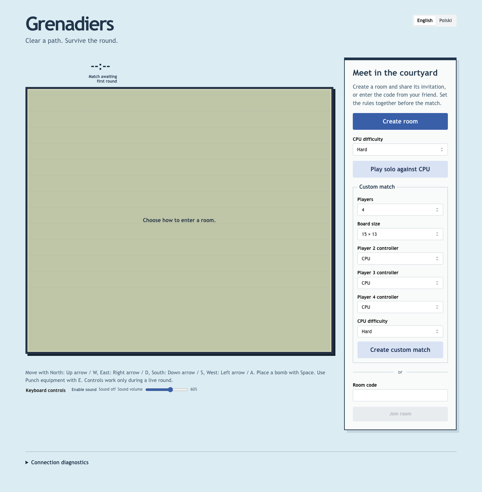

# Hard difficulty controls — v1.3.0

Captured from the accepted paired gameplay19 image. Hard is selected for Solo and a custom
four-seat match with three CPUs. The two selectors share one choice; a fresh lobby defaults
to Standard. The custom tier applies to every CPU seat.

The native Polish scenario also verifies Standard as the initial value, keyboard creation
of Hard Solo at 320 pixels, no horizontal overflow and accessibility. See the
[release record](../releases.md#v130--2026-11-01) for verification.
