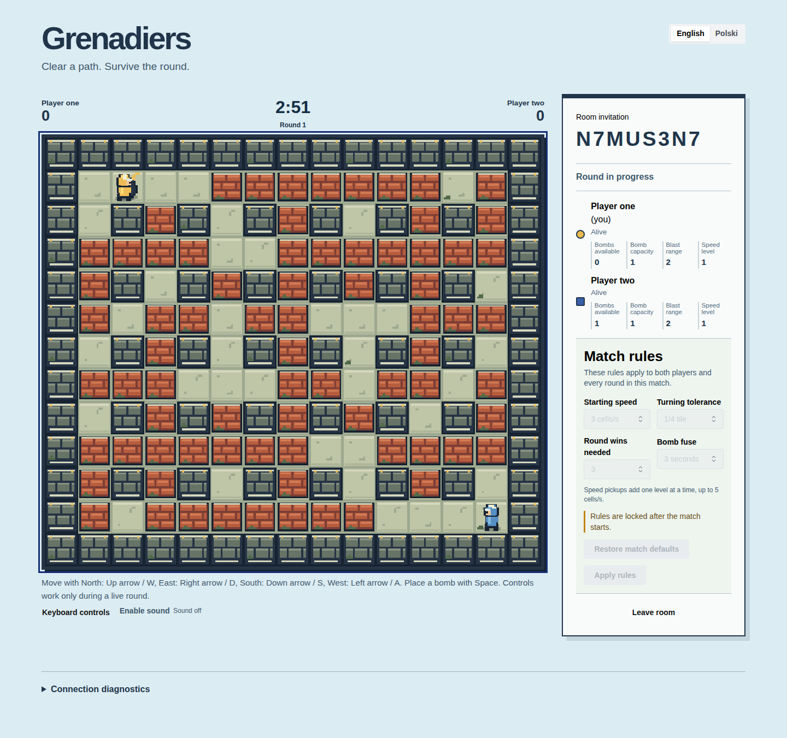
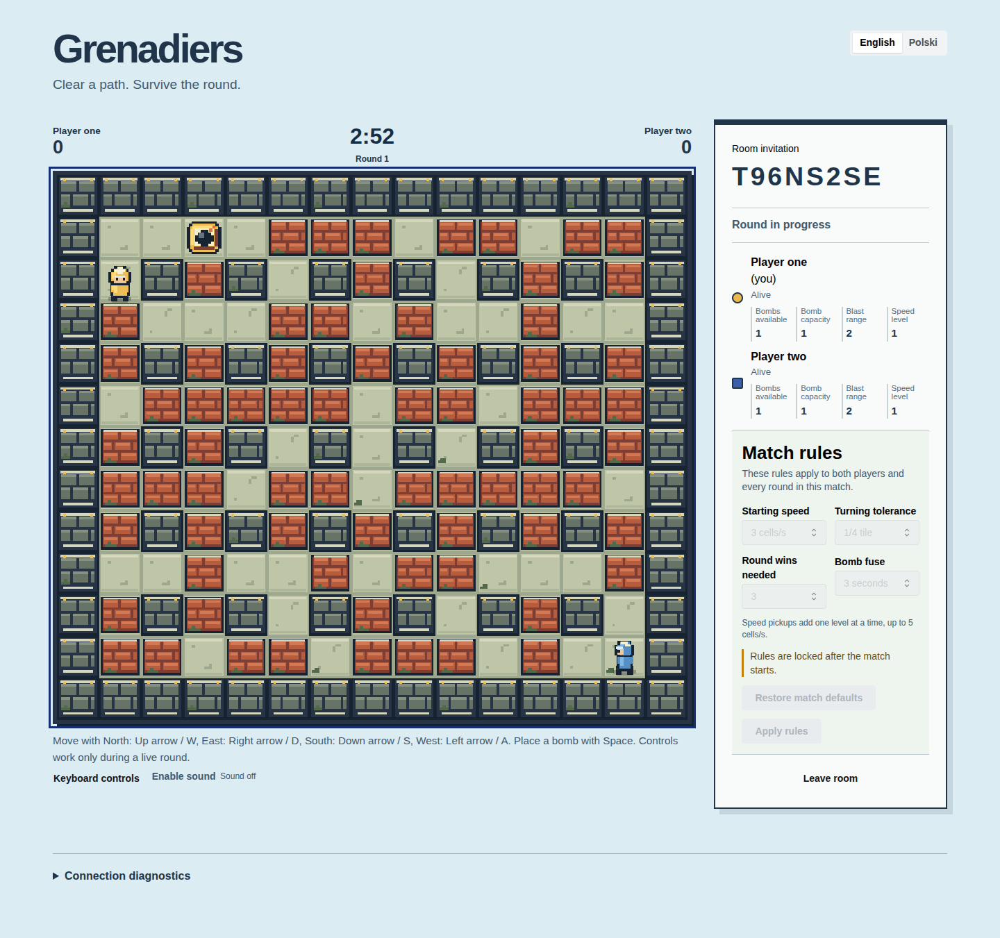
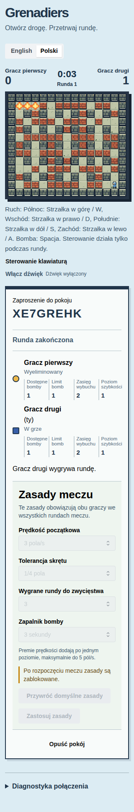

# Retro pixel-art application captures

Actual v0.3.18 application frames from clean source
`1f591c2e86c78e19e4af1fb12a020f3ecd72c1ed`, 2026-10-17. Both deployments use image
`sha256:d8a99fef496cd0cb719308e62d77914945d4f695d04ec718354922db6c0b1967`.
Invitations belong to removed test rooms and are public discovery data. These are native
gameplay captures, separate from the earlier visual studies.

Desktop running round with a planted bomb and both players:

Desktop exposed capacity pickup and detailed terrain:

Polish 320-pixel view of the terminal flame/result frame. The round has ended; flames and
the surviving actor are retained in the accepted result, with decorative animation stopped:

All captures pass visual inspection; the narrow native capture also checks viewport overflow.
